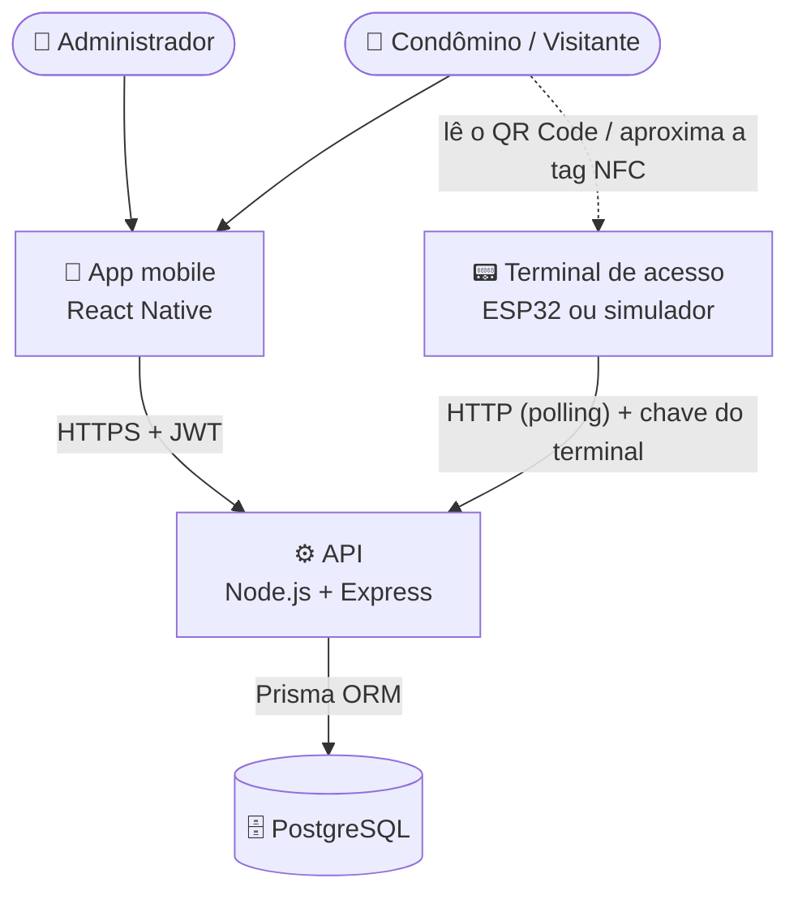

 

 

---

## Sobre o Desafio

> **Passe** é um sistema integrado de controle de acesso para edifícios e condomínios, desenvolvido como projeto da **ABP 2026-2** (Aprendizagem Baseada em Projetos) da **FATEC Jacareí**.

O desafio é construir, de ponta a ponta, uma solução em que uma pessoa entra por uma catraca **sem cartão e sem porteiro**: ela lê o QR Code exibido no terminal com o celular, ou aproxima uma tag NFC, e o sistema decide na hora se libera ou nega a passagem. Toda tentativa, aprovada ou negada, fica registrada.

A solução é formada por três partes que conversam entre si:

- **Terminal de acesso** (ESP32 ou simulador): instalado na catraca, mostra um QR Code que muda a cada 10 segundos, lê tags NFC e abre ou nega a passagem.
- **App mobile**: o administrador cadastra usuários, locais e autorizações; o usuário lê o QR Code da catraca para entrar e consulta as próprias autorizações e o histórico.
- **API**: gera os QR Codes, valida cada tentativa (autorização, período, horário, número de usos e distância de até 100 m), manda o terminal abrir ou negar e registra um evento por tentativa.

---

## Arquitetura

---

## Funcionalidades

| 🔐 Autenticação | 👥 Cadastros | 🗺 Locais de acesso |
|:---:|:---:|:---:|
| Login com JWT e perfis | Administrador, condômino e visitante | Edifícios, portarias, portas e catracas |
| **📝 Autorizações** | **📱 Acesso por QR Code** | **💳 Acesso por NFC** |
| Período, horário e número de usos | QR de uso único, renovado a cada 10 s | Tag vinculada ao usuário, resposta em até 2 s |
| **📍 Proximidade** | **📜 Histórico** | **📡 Terminal offline** |
| Só entra quem está a até 100 m do terminal | Tentativas aprovadas e negadas, com filtros | Eventos enviados em lote ao reconectar |

---

## Requisitos Funcionais

<b>RF01 a RF05 — Cadastros e autorizações</b>

 

- **RF01 — Cadastro de usuários:** perfis administrador, condômino e visitante; usuários são desativados, nunca excluídos.
- **RF02 — Locais de acesso:** edifícios, pontos de acesso (portaria, porta, catraca) e terminais, com coordenadas.
- **RF03 — Criar autorização:** pessoa, local, data de início e fim, hora de início e fim, número de usos e situação.
- **RF04 — Consultar autorizações:** o administrador filtra por pessoa, local, situação e período.
- **RF05 — Cancelar autorização:** o cancelamento tem efeito imediato.

<b>RF06 a RF08 — Histórico, autenticação e minhas autorizações</b>

 

- **RF06 — Histórico:** consulta das tentativas aprovadas e negadas, com filtros.
- **RF07 — Autenticação:** login seguro, permissões por perfil e limite de tentativas.
- **RF08 — Minhas autorizações:** cada usuário vê somente as próprias.

<b>RF09 e RF10 — App</b>

 

- **RF09 — Leitura do QR Code:** o usuário aponta a câmera do celular para o QR Code da catraca.
- **RF10 — Tags NFC:** o administrador cadastra e vincula tags NFC aos usuários.

<b>RF11 a RF17 — Terminal e validação de acesso</b>

 

- **RF11 — Terminal:** identifica-se à API e informa posição e estado.
- **RF12 — QR Code:** gerado pela API, renovado a cada 10 segundos e de uso único.
- **RF13 — Validação por QR Code:** confere autenticidade, validade, local, situação da autorização, usos restantes e proximidade de até 100 m.
- **RF14 — Validação por NFC:** tag, usuário e autorização, com resposta em até 2 segundos.
- **RF15 — Liberação:** a API manda o terminal abrir.
- **RF16 — Negação:** a API manda o terminal negar, com o motivo.
- **RF17 — Registro do evento:** exatamente um evento por tentativa, aprovada ou negada.

<b>Requisitos não funcionais</b>

 

- **Segurança:** senhas e chaves guardadas apenas como hash, segredos fora do repositório, autenticação do terminal e validação de toda entrada.
- **Confiabilidade:** eventos gerados offline não se perdem e não se duplicam.
- **Persistência:** banco PostgreSQL em nuvem, com migrações versionadas.
- **Qualidade:** código em camadas, desenvolvido com TDD.
- **Entrega:** Docker, pipeline de CI com build, lint e testes (sem testes automatizados o projeto não é aceito) e deploy após o CI verde.

---

## Stack Tecnológica

&nbsp;
&nbsp;
&nbsp;
&nbsp;
&nbsp;
&nbsp;
&nbsp;
&nbsp;
&nbsp;
&nbsp;
&nbsp;

---

## Estrutura do Repositório

Cada pasta tem o seu próprio README, com instalação, comandos e documentação da parte.

| Pasta | Conteúdo |
|:---|:---|
| [backend/](backend/) | API e banco de dados |
| [mobile/](mobile/) | App mobile |
| [terminal/](terminal/) | Terminal de acesso (IoT) |
| [infra/](infra/) | Infraestrutura e deploy |
| [docs/](docs/) | Documentação geral do projeto |

---

## Equipe

Projeto desenvolvido pela equipe **DevFlow** — FATEC Jacareí.

| Integrante | Função |
|:---|:---|
| Eduardo Silva Machado | Dev Back |
| Pedro | Dev Mobile |
| Matheus | Dev IoT |
| Rafael Medeiros | Design |

---

Desenvolvido pela equipe **DevFlow** · FATEC Jacareí · ABP 2026-2

