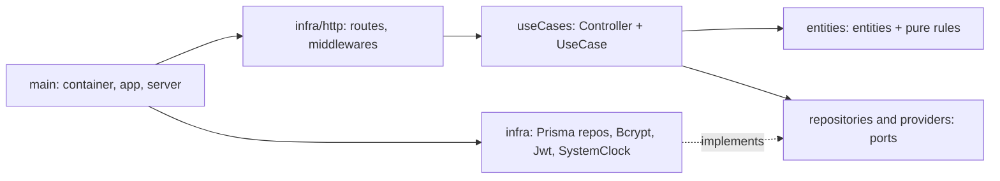

# 01 — Architecture (Clean Architecture + SOLID, use-case-per-folder)

Load this file when creating or moving files, or adding a use case, repository, provider or middleware.

This structure evolves the author's `node_server_template` and `estudos_dpi_server` repositories. The reasoning and the list of changes against those repositories are in `ANALISE-ESTRUTURA.md` (human document; not needed for coding).

## 1. Layers and the dependency rule

Dependencies point inward only: `infra → useCases → entities`. Ports (interfaces) live in the inner layers; implementations live in `infra`.



| Layer | Folder | May import | Must never import |
|---|---|---|---|
| Entities | `src/entities` | nothing outside itself | express, prisma, any library with IO, `process.env`, `Date.now()` |
| Ports | `src/repositories`, `src/providers` | `entities` | any implementation |
| Use cases | `src/useCases` | `entities`, ports, `shared/errors` | express (except types in Controller), prisma, bcrypt, jwt, `infra/*` (except in `index.ts`) |
| Infra | `src/infra` | everything inward, libraries | other use cases' internals |
| Main | `src/main` | everything | — |

Only the use case's `index.ts` may import from `src/main/container.ts`. Specs never import `index.ts`.

## 2. Folder structure

```
backend/
  prisma/              schema.prisma, migrations/, seed.ts
  src/
    config/env.ts            zod-validated environment, typed
    shared/errors/AppError.ts
    entities/                User.ts, Authorization.ts, Terminal.ts, ...
      rules/                 pure functions: effectiveStatus, distance, timeWindow, AccessEvaluator
    repositories/            ports only: IUserRepository.ts, ...
    providers/               ports only: IClock, IHashProvider, ITokenProvider,
                             ISecureRandom, IIdGenerator, ILogger
    useCases/
      Health/ Auth/ Users/ Locations/ Terminals/ Authorizations/
      TerminalChannel/ Access/ Nfc/ Events/
        <UseCaseName>/
          <Name>_UseCase.ts   business logic, no HTTP
          <Name>_Controller.ts  HTTP only: parse, call, respond
          <Name>_DTO.ts       zod schema + inferred type
          <Name>_UseCase.spec.ts  unit tests (colocated)
          index.ts            wiring: builds the controller
    infra/
      database/prisma.ts      the single PrismaClient factory
      repositories/           PrismaUserRepository.ts, ...
      providers/              BcryptHashProvider, JwtTokenProvider, SystemClock, PinoLogger
      http/                   middlewares, errorHandler, rate limits, adapt.ts
      jobs/                   scheduled tasks (purge expired QR credentials)
    main/
      app.ts                  builds Express, no listen
      server.ts               listen
      container.ts            singletons: prisma, providers, repositories
      routes/                 one file per module: auth.routes.ts, users.routes.ts, ...
  test/
    doubles/                  InMemory repositories, FakeClock, FakeHashProvider, ...
    factories/                makeUser(), makeAuthorization(), ...
    integration/              supertest + real PostgreSQL
```

Internal-only collaborators (for example `AccessEventRecorder`) live in the module folder without Controller or DTO.

## 3. Anatomy of a use case

DTO: validation lives at the HTTP edge only.

```typescript
// CreateAuthorization_DTO.ts
import { z } from 'zod';

export const CreateAuthorizationSchema = z.object({
  usuarioId: z.string().uuid(),
  accessPointId: z.string().uuid(),
  dataInicio: z.string().regex(/^\d{4}-\d{2}-\d{2}$/),
  dataFim: z.string().regex(/^\d{4}-\d{2}-\d{2}$/),
  horaInicio: z.string().regex(/^([01]\d|2[0-3]):[0-5]\d$/),
  horaFim: z.string().regex(/^([01]\d|2[0-3]):[0-5]\d$/),
  usosPermitidos: z.number().int().min(1).max(1000),
});

export type ICreateAuthorizationDTO = z.infer<typeof CreateAuthorizationSchema>;
```

Use case: constructor receives ports (DIP), never concrete classes.

```typescript
// CreateAuthorization_UseCase.ts
export class CreateAuthorizationUseCase {
  constructor(
    private users: IUserRepository,
    private accessPoints: IAccessPointRepository,
    private authorizations: IAuthorizationRepository,
    private ids: IIdGenerator,
    private clock: IClock,
  ) {}

  async execute(input: ICreateAuthorizationDTO, adminId: string) {
    const user = await this.users.findById(input.usuarioId);
    if (!user) throw new NotFoundError('Usuário não encontrado');
    if (!user.ativo) throw new ValidationError('Dados inválidos', [
      { field: 'usuarioId', message: 'Usuário inativo' },
    ]);
    // ... other rules, using this.clock.now()
    const authorization = Authorization.create({ id: this.ids.next(), ...input,
      criadoPorId: adminId, criadoEm: this.clock.now() });
    await this.authorizations.save(authorization);
    return authorization;
  }
}
```

Controller: parse, call, respond. No try/catch (Express 5 forwards rejected promises to the error handler).

```typescript
// CreateAuthorization_Controller.ts
export class CreateAuthorizationController {
  constructor(private useCase: CreateAuthorizationUseCase) {}

  async handle(req: Request, res: Response) {
    const data = CreateAuthorizationSchema.parse(req.body);
    const created = await this.useCase.execute(data, req.auth!.userId);
    return res.status(201).json(toAuthorizationResponse(created));
  }
}
```

Wiring and route:

```typescript
// index.ts
import { container as c } from '../../../main/container';

const useCase = new CreateAuthorizationUseCase(
  c.users, c.accessPoints, c.authorizations, c.ids, c.clock);
export const createAuthorizationController = new CreateAuthorizationController(useCase);

// main/routes/authorizations.routes.ts
router.post('/authorizations', authenticate(), authorize('ADMIN'),
  adapt(createAuthorizationController));
```

`adapt` returns the promise so Express 5 can catch rejections:

```typescript
export const adapt = (c: { handle(req: Request, res: Response): Promise<unknown> }) =>
  (req: Request, res: Response) => c.handle(req, res);
```

## 4. Errors

All HTTP-level errors extend `AppError` and serialize to `{ "error": { "code", "message", "details?" } }`.

```typescript
export class AppError extends Error {
  constructor(
    public readonly code: string,
    message: string,
    public readonly status: number,
    public readonly details?: Array<{ field: string; message: string }>,
  ) { super(message); }
}
export class ValidationError extends AppError {   // 422 VALIDATION_ERROR
  constructor(message: string, details?: AppError['details']) {
    super('VALIDATION_ERROR', message, 422, details);
  }
}
// UnauthorizedError 401, ForbiddenError 403, NotFoundError 404 (NOT_FOUND),
// ConflictError 409 (specific code, e.g. EMAIL_JA_CADASTRADO), RateLimitedError 429
```

Central handler (`infra/http/errorHandler.ts`): `ZodError` → 422 with `details` per field; malformed JSON → 422; `AppError` → its status; anything else → 500 `INTERNAL_ERROR` with a generic message, logged with the request id, never the stack in production.

## 5. Access decisions are values

Business denials are not exceptions. The access use cases return:

```typescript
export type DenialReason =
  | 'CREDENCIAL_INVALIDA' | 'CREDENCIAL_EXPIRADA' | 'CREDENCIAL_REUTILIZADA'
  | 'USUARIO_INATIVO' | 'SEM_AUTORIZACAO' | 'AUTORIZACAO_CANCELADA'
  | 'FORA_DO_PERIODO' | 'USOS_ESGOTADOS' | 'DISTANTE_DO_TERMINAL'
  | 'LOCALIZACAO_INVALIDA' | 'TAG_DESCONHECIDA' | 'TAG_INATIVA';

export type AccessDecision =
  | { granted: true; authorizationId: string; usosRestantes: number; distanceM?: number }
  | { granted: false; reason: DenialReason };
```

The QR controller maps `granted: false` to HTTP 403 with `error.code = reason`. The NFC controller always answers 200 with `resultado` in the body.

Pure rules (`entities/rules`) receive everything as arguments, including `now: Date`:

- `computeEffectiveStatus(authorization, now)`
- `isWithinWindow(authorization, now)`: dates and times in `America/Sao_Paulo`, limits inclusive
- `haversineDistanceM(a, b)`
- `AccessEvaluator.evaluate({ user, accessPointId, authorizations, now })`: the shared evaluator for QR and NFC (checks 6 to 9 of the order in file 03)

## 6. Persistence

- One `PrismaClient`, created in `infra/database/prisma.ts` and injected into every Prisma repository by constructor. Repositories never `new PrismaClient()`.
- Repositories return entities or plain read models, never Prisma model objects. Each Prisma repository has a private `toEntity()` mapper. This keeps `senhaHash`, `apiKeyHash` and other internals from leaking by accident.
- Entities do not import `@prisma/client`. Enum-like values are string-literal unions in `entities`.
- Atomic operations get a dedicated port that hides the transaction:

```typescript
export interface IAccessGrantRepository {
  commitApproval(input: {
    credentialId: string;
    authorizationId: string;
    now: Date;
    event: NewAccessEvent;
    command: NewTerminalCommand;
  }): Promise<
    | { ok: true; usosRestantes: number }
    | { ok: false; reason: 'CREDENCIAL_REUTILIZADA' | 'USOS_ESGOTADOS' }
  >;
}
```

The Prisma implementation runs conditional updates inside `$transaction` and checks the affected row count (`consumidoEm IS NULL`; `usosRealizados < usosPermitidos AND situacao = 'ATIVA'`). The in-memory double mimics the same all-or-nothing behavior (snapshot and rollback on failure).

## 7. Ports catalog

| Port | Folder | Methods (initial) | Real implementation | Test double |
|---|---|---|---|---|
| `IClock` | providers | `now(): Date` | `SystemClock` | `FakeClock` with `set()` and `advance(ms)` |
| `IIdGenerator` | providers | `next(): string` | `UuidGenerator` | `SequentialIdGenerator` |
| `ISecureRandom` | providers | `base64Url(bytes): string` | `CryptoRandom` | `FixedRandom` |
| `IHashProvider` | providers | `hash(plain)`, `compare(plain, hash)`; also `sha256(text)` for QR and terminal keys | `BcryptHashProvider` | `FakeHashProvider` |
| `ITokenProvider` | providers | `sign(payload)`, `verify(token)` | `JwtTokenProvider` | `FakeTokenProvider` |
| `ILogger` | providers | `info`, `warn`, `error` | `PinoLogger` | `SpyLogger` |
| `IUserRepository` | repositories | `findById`, `findByEmail`, `existsByEmail`, `save`, `list`, `countActiveAdmins` | Prisma | InMemory |
| other repositories | repositories | created by the step that needs them (`IBuildingRepository`, `IAccessPointRepository`, `ITerminalRepository`, `IAuthorizationRepository`, `INfcTagRepository`, `IQrCredentialRepository`, `ITerminalCommandRepository`, `IAccessEventRepository`, `IAccessGrantRepository`) | Prisma | InMemory |

Create a port only when a step needs it. Do not create empty folders or speculative interfaces.

## 8. Composition root

`src/main/container.ts` creates every singleton once: Prisma client, providers, repositories. `index.ts` files take what they need from it. Configuration comes from `config/env.ts` and reaches use cases as small config objects through the constructor (`{ qrTtlSeconds, toleranceSeconds, maxDistanceM }`), never as `process.env` reads.

## 9. HTTP wiring

`main/app.ts` builds the app in this order: request id, request logging, `helmet`, `cors` (origins from env), `express.json({ limit: '100kb' })`, routers under `/api/v1`, 404 handler, error handler. `main/server.ts` only calls `listen`, so supertest imports `app` without opening a port.

Middlewares in `infra/http`: `authenticate({ allowInactive? })`, `authorize(...perfis)`, `authenticateTerminal`, rate limiters. Middlewares reload the user or terminal through ports; they hold no business rules.

The authenticated identity is exposed as `req.auth` (`{ userId, perfil }`) for users and `req.terminal` (`{ terminalId, accessPointId }`) for terminals. Declare both by augmenting Express `Request` in `src/@types/express/index.d.ts` (the template's `typeRoots` already points to `src/@types`).

## 10. Checklist: adding a use case

1. Write the test list in the spec as `it.todo(...)` (file 02).
2. Define DTO schema, entity changes and port methods (types only) so tests compile.
3. Red → green → refactor on the use case with doubles.
4. Add the Controller, `index.ts` and the route; write the integration test first.
5. Implement the Prisma repository method; run the integration test.
6. Update `openapi.yaml`, `STATUS.md`, tick acceptance criteria.

## 11. Overrides to the older plan

The earlier backend plan (B01 folder tree and the "routes → controller → service → repository" DoD item) is superseded by this file. Mapping: **use case = service layer**; Controller = HTTP adapter; repository ports + `infra` implementations. Course requirement RNF05 (modular layers, no business logic in routes) is still satisfied.
