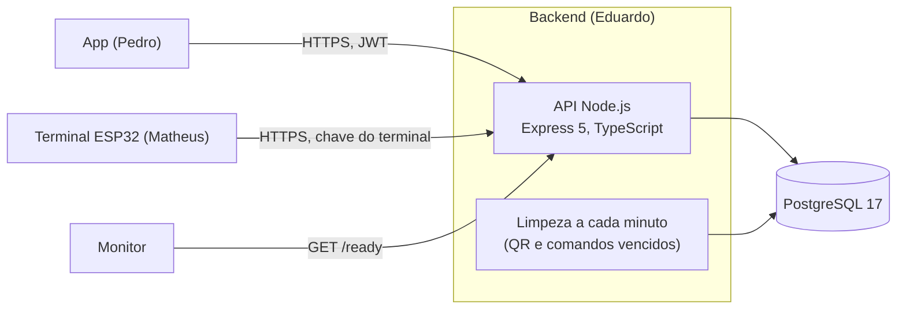
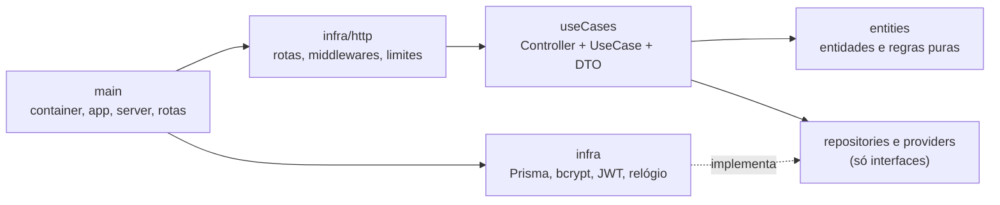

# Arquitetura do backend

Seção "Backend" do documento de arquitetura do projeto (ABP 2026-2, controle de acesso integrado). O restante do sistema (app e terminal) tem documentação própria; aqui está só o que a API faz e como ela é organizada.

## 1. Visão geral

A API atende dois clientes e guarda tudo em um PostgreSQL. Ela gera o QR Code de cada terminal, decide cada tentativa de acesso, registra uma linha de histórico por tentativa e diz ao terminal o que fazer.

| Item | Escolha |
|---|---|
| Linguagem e framework | TypeScript (`strict`), Node.js 24, Express 5 |
| Banco | PostgreSQL 17, acesso por Prisma 7 (adaptador `pg`) |
| Validação | zod, na borda HTTP |
| Autenticação | JWT HS256 para o app; chave própria (guardada como SHA-256) para o terminal |
| Logs | pino, em JSON, com um `X-Request-Id` por requisição |
| Testes | Vitest (unitários e integração) e supertest; PostgreSQL real nos de integração |
| Empacotamento | Docker (multi-stage, usuário sem privilégios) e `docker compose` |
| CI | GitHub Actions: lint, tipos, build, testes e cobertura |

## 2. Camadas e regra de dependência

Clean Architecture com um use case por pasta. As dependências apontam só para dentro.

| Camada | Pasta | Pode importar | Nunca importa |
|---|---|---|---|
| Entidades e regras | `src/entities` | nada de fora | Express, Prisma, `process.env`, `Date.now()` |
| Portas | `src/repositories`, `src/providers` | entidades | qualquer implementação |
| Casos de uso | `src/useCases` | entidades e portas | Express (só tipos no Controller), Prisma, bcrypt, jsonwebtoken, `infra` |
| Infraestrutura | `src/infra` | tudo que está dentro | |
| Composição | `src/main` | tudo | |

A regra é verificada pelo ESLint (`npm run lint`) e o CI falha se alguém a quebrar. O tempo entra sempre por `IClock`, então prazo de QR, janela de autorização e validade de comando são testados com um relógio falso.

## 3. Decisões que moldam o código

- **Negação de acesso é valor, não exceção.** A validação devolve `AUTORIZADO` ou `NEGADO` com um código de motivo. Exceções (`AppError`) ficam para problemas HTTP: validação, autenticação, não encontrado, conflito.
- **Um evento por tentativa.** Toda tentativa, aprovada ou negada, gera exatamente uma linha em `access_events`. Aprovar nunca acontece sem o evento.
- **Aprovação atômica.** Consumir a credencial do QR, consumir um uso, gravar o evento e criar o comando acontecem na mesma transação do banco. A concorrência é provada com testes de integração no PostgreSQL real, não com fakes.
- **Eventos são somente inserção.** Não existe rota que edite ou apague um evento.
- **Regras puras compartilhadas.** O `AccessEvaluator` (autorização, período, usos) serve ao QR e ao NFC. A regra dos 100 m vale só para o QR.
- **Fuso.** Instantes em UTC; datas e horas das autorizações são avaliadas em `America/Sao_Paulo`, com limites inclusivos.
- **Idempotência.** O NFC usa o `Idempotency-Key` e o lote offline usa o `clientEventId`; repetir não consome uso nem duplica evento.
- **Segredos só como hash.** Senhas (bcrypt), chaves de terminal e tokens de QR (SHA-256) nunca ficam em texto puro, nem no banco nem no log.

## 4. Fluxos principais

Os diagramas de sequência estão em [sequencias.md](sequencias.md): acesso por QR, acesso por NFC e lote de eventos sem conexão. A comunicação com o app e com o terminal, rota por rota, está em [comunicacao.md](comunicacao.md).

## 5. Dados

Nove tabelas, descritas em [modelo-de-dados.md](modelo-de-dados.md) (gerado do `schema.prisma`; um teste falha se ficar desatualizado). Regras de integridade vão em `CHECK` na migração, e todas as chaves estrangeiras são `ON DELETE RESTRICT`: registros se desativam, nunca se apagam.

## 6. Segurança

Resumo; o checklist completo, com a evidência de cada item, está em [seguranca.md](seguranca.md).

- HTTPS pelo provedor, com HSTS de um ano em produção; `helmet` e CORS por lista de origens.
- Limites de requisição: login (por IP e e-mail), validação de QR (por usuário), terminal (por terminal), falhas de autenticação do terminal (por IP) e rotas públicas (por IP).
- Validação de entrada com zod em todas as rotas, conferida por um teste que percorre as rotas registradas.
- Erros sem rastro interno em produção; logs sem senha, token ou chave.

## 7. Operação

- **Saúde e prontidão.** `GET /health` mostra que o processo está vivo e o estado do banco (sempre 200); `GET /ready` dá 503 quando o banco não responde e serve para alertas.
- **Logs.** JSON no stdout, um por requisição, com `X-Request-Id` e sem cabeçalhos secretos.
- **Limpeza.** Dois jobs a cada minuto (iniciados em `server.ts`, nunca em `app.ts`) apagam credenciais de QR e comandos vencidos há mais do tempo configurado.
- **Migrações.** `prisma migrate deploy` (`npm run db:deploy` ou `docker compose run --rm migrate`).
- **Backup.** [backup-e-restauracao.md](backup-e-restauracao.md).
- **Configuração.** Variáveis de ambiente validadas na partida (`src/config/parseEnv.ts`); a API não sobe com configuração inválida. Lista em `.env.example`.

## 8. Limitações conhecidas

- **UID de NFC é clonável.** É uma limitação aceita do projeto, não um defeito da API; o risco está registrado na decisão 12 do contrato.
- **Limites na memória do processo.** Os contadores de requisição não são compartilhados entre instâncias. Com mais de uma instância da API, cada uma conta à parte.
- **Um terminal comprometido pode forjar negações offline** em nome de quem tem tag, porque ele escolhe o UID do lote. É da mesma família do UID clonável.
- **O IP depende do proxy.** Atrás de um proxy ou balanceador, `TRUST_PROXY` precisa ter o número de proxies; com o valor errado os limites por IP valem para todos juntos ou podem ser contornados.
- **Dependem do ambiente publicado (B10):** HTTPS real, o alerta de queda em até 5 minutos e a medida de tempo de resposta em homologação.
