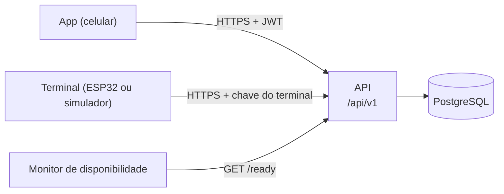

# Comunicação do backend com o terminal e com o app

A API é uma só e atende dois clientes que se autenticam de formas diferentes. Contrato completo, com exemplos de cada resposta: [openapi.yaml](../openapi.yaml) (Swagger em `/docs`).

## Convenções comuns

| Tema | Regra |
|---|---|
| Base | `/api/v1` (o Swagger fica em `/docs`, fora dele) |
| Formato | JSON em UTF-8. Instantes em ISO 8601 UTC (`2026-10-20T14:32:07Z`). Data de autorização `YYYY-MM-DD` e hora `HH:mm`, avaliadas em `America/Sao_Paulo` |
| IDs | UUID v4 em texto. Exceção: o `id` de um comando do terminal é um inteiro crescente |
| Erro | `{ "error": { "code", "message", "details?" } }`. `details` só aparece em validação (`422`) |
| Status | `200`/`201` sucesso · `401` sem login, token ou chave válidos · `403` perfil sem permissão **ou acesso negado** · `404` · `409` conflito · `413` corpo grande demais · `422` validação · `429` limite de requisições · `500` erro interno |
| Tamanho do corpo | até 100 kb em qualquer rota; `POST /terminal/events/batch` aceita até 64 kb |
| Rastreio | toda resposta traz `X-Request-Id`. O mesmo id aparece nas linhas de log da requisição. Quem reclama de um erro pode informar esse id |
| Limites | `429 RATE_LIMITED` com o cabeçalho `Retry-After`. Cada limite é descrito na seção [Limites de requisição](seguranca.md#limites-de-requisição) |

## App (usuários)

**Autenticação:** `Authorization: Bearer <accessToken>`, obtido em `POST /auth/login`. O token dura `JWT_EXPIRES_IN` (12 h por padrão). O perfil e a situação do usuário são lidos do banco a cada requisição, então desativar uma conta vale na hora (`401`).

| O app faz | Rota | Perfil |
|---|---|---|
| Entrar e ver quem sou | `POST /auth/login`, `GET /auth/me` | qualquer |
| Cadastrar usuários, locais, terminais e tags | `/users`, `/buildings`, `/access-points`, `/terminals`, `/nfc-tags` | `ADMIN` |
| Criar, listar e cancelar autorizações | `POST /authorizations`, `GET /authorizations`, `PATCH /authorizations/{id}/cancel` | `ADMIN` |
| Ver as próprias autorizações | `GET /me/authorizations` | qualquer |
| **Abrir a catraca por QR Code** | `POST /access/qr/validate` | qualquer, inclusive conta inativa (a tentativa fica registrada) |
| Ver o histórico | `GET /access-events` (todos) · `GET /me/access-events` (os próprios) | `ADMIN` · qualquer |

O app **não fala com o terminal**: lê o QR Code na tela dele, manda o texto lido ao backend e recebe a decisão. A negação de acesso é um `403` cujo `error.code` é o motivo (`FORA_DO_PERIODO`, `DISTANTE_DO_TERMINAL`, ...) e cuja `message` já é o texto que o app mostra.

## Terminal

**Autenticação:** `X-Terminal-Id: <uuid>` e `X-Terminal-Key: <chave>` em toda chamada. O banco guarda só o SHA-256 da chave. Uma chave errada ou um id desconhecido dão a mesma resposta (`401`, sem dizer qual dos dois errou); um terminal desativado dá `403`. A chave é mostrada **uma vez**, ao criar o terminal ou ao girá-la (`POST /terminals/{id}/rotate-key`).

| O terminal faz | Rota | Cadência |
|---|---|---|
| Avisar que está vivo e onde está; receber a configuração | `POST /terminal/heartbeat` | a cada alguns segundos (mínimo `HEARTBEAT_MIN_INTERVAL_S`) |
| Pedir o QR Code a desenhar | `POST /terminal/qr` | a cada `renovarEmMs` (10 s) |
| Buscar o que fazer com a catraca (QR) | `GET /terminal/commands` | a cada `commandPollMs` (1 s) |
| Confirmar que executou um comando | `POST /terminal/commands/{id}/ack` | uma vez por comando |
| **Enviar a tag NFC lida e receber a decisão** | `POST /terminal/nfc` (com `Idempotency-Key`) | a cada leitura |
| Enviar o que guardou sem rede | `POST /terminal/events/batch` | ao reconectar |

### O que o heartbeat devolve

`serverTime` (para o terminal acertar o relógio) e `config` com `qrRefreshMs`, `commandPollMs` e `aberturaMs`. Esses valores vêm do ambiente do servidor: ajustar a cadência não exige reprogramar o terminal. O backend usa o **relógio do servidor** para todas as decisões; o relógio do terminal só informa quando uma leitura offline aconteceu.

### Como o terminal recebe a decisão

| Caminho | Como a decisão chega | Rota que a produz |
|---|---|---|
| **QR** | indireta: o app valida e o backend cria um comando. O terminal o encontra no `GET /terminal/commands`: `ABRIR` (com `aberturaMs`) ou `NEGAR` (com `motivo`) | `POST /access/qr/validate` |
| **NFC** | direta: na resposta da própria leitura, sempre `200`: `{ "resultado": "AUTORIZADO", "aberturaMs": 5000 }`, `{ "resultado": "NEGADO", "motivo": "..." }` ou `{ "resultado": "CADASTRADA" }` | `POST /terminal/nfc` |

Um comando só é entregue enquanto tiver até `COMMAND_TTL_SECONDS` (10 s) de vida; depois disso nunca mais. Os diagramas passo a passo estão em [sequencias.md](sequencias.md).

### Quando não há rede

O terminal **nega** as leituras NFC e as guarda com um `clientEventId` (UUID). Ao reconectar, envia tudo em `POST /terminal/events/batch` e só apaga o que guardou depois de receber `200`. Reenviar é seguro: os eventos já recebidos entram em `duplicados`. Um `500` significa que nada foi confirmado. O terminal nunca envia aprovação offline, e a API recusa (`422`).

## Monitor de disponibilidade

`GET /api/v1/ready` é pública e feita para monitores e balanceadores:

| Resposta | Significa |
|---|---|
| `200 { "status": "ready", "db": "up", "time": "..." }` | a API atende e o banco responde |
| `503 { "status": "unavailable", "db": "down", "time": "..." }` | o banco não responde: a API está de pé, mas não consegue trabalhar |

`GET /api/v1/health` responde `200` mesmo com o banco fora, mostrando `db: down`. Use o `/ready` para alertas e o `/health` para saber se o processo está vivo. Os dois têm limite de requisições por IP (`PUBLIC_MAX_PER_MINUTE`).
