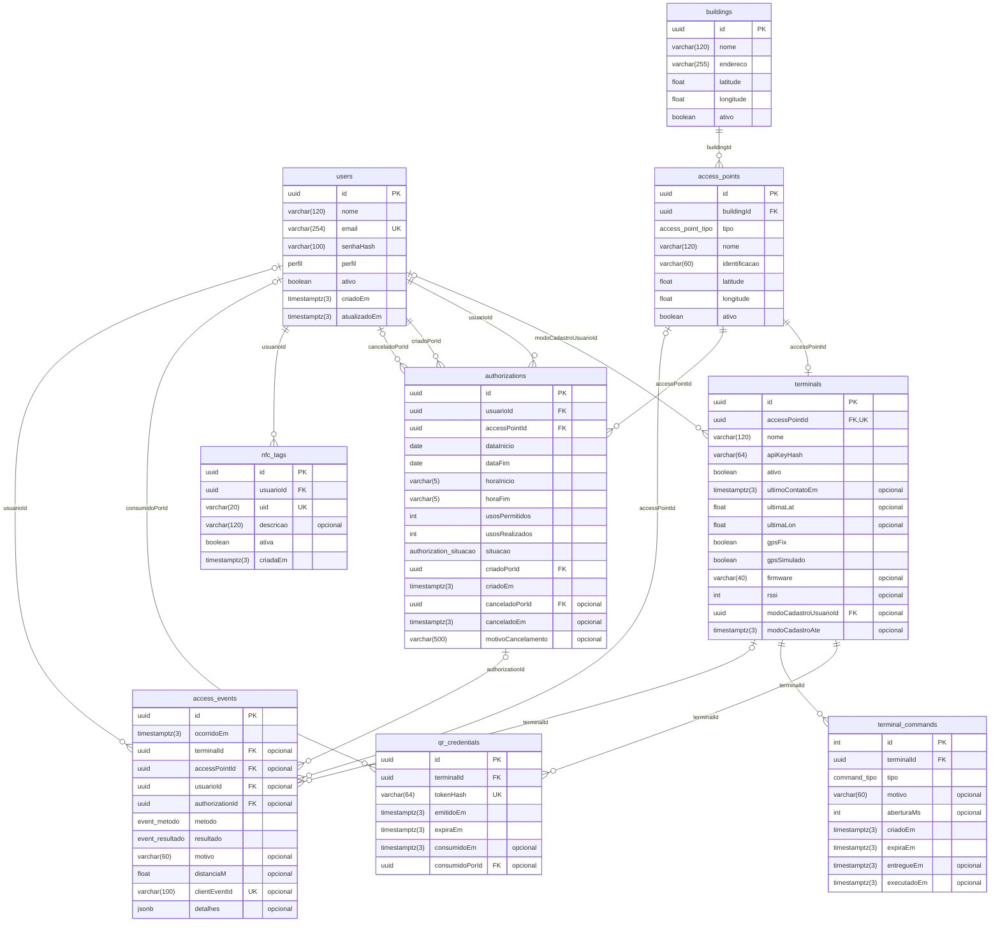

# Modelo de dados v1

> Gerado por `npm run db:erd` a partir de `prisma/schema.prisma`. Não edite à mão: rode o comando
> de novo depois de mudar o schema (um teste falha se este arquivo ficar desatualizado).

## Diagrama

Legenda: `PK` chave primária, `FK` chave estrangeira, `UK` valor único, `"opcional"` aceita nulo.
Toda chave estrangeira é `ON DELETE RESTRICT`: registros são desativados (`ativo`), nunca apagados.

## Enums

| Tipo no banco | Valores |
| --- | --- |
| `perfil` | ADMIN, CONDOMINO, VISITANTE |
| `access_point_tipo` | PORTARIA, PORTA, CATRACA |
| `authorization_situacao` | ATIVA, CANCELADA |
| `command_tipo` | ABRIR, NEGAR |
| `event_metodo` | QR, NFC |
| `event_resultado` | AUTORIZADO, NEGADO |

## Restrições que não aparecem no diagrama

Os `CHECK` (usos e datas da autorização, formato de horas, coordenadas, formato de UID de NFC,
validade de QR e de comando, e o formato de bcrypt e SHA-256 dos hashes) não existem no Prisma.
Ficam em SQL no fim de `prisma/migrations/*_modelo_de_dados_v1/migration.sql`, com nomes no padrão
`<tabela>_<regra>_chk`.
