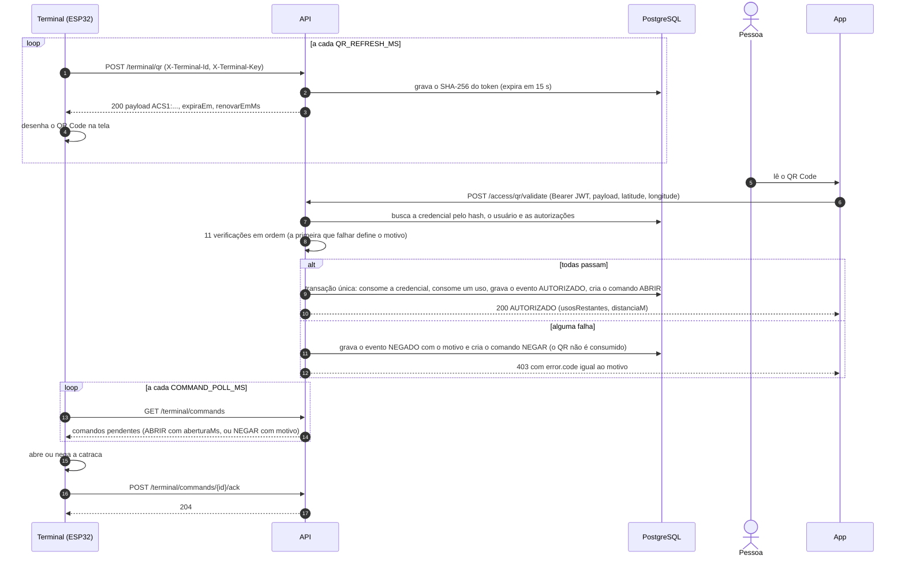
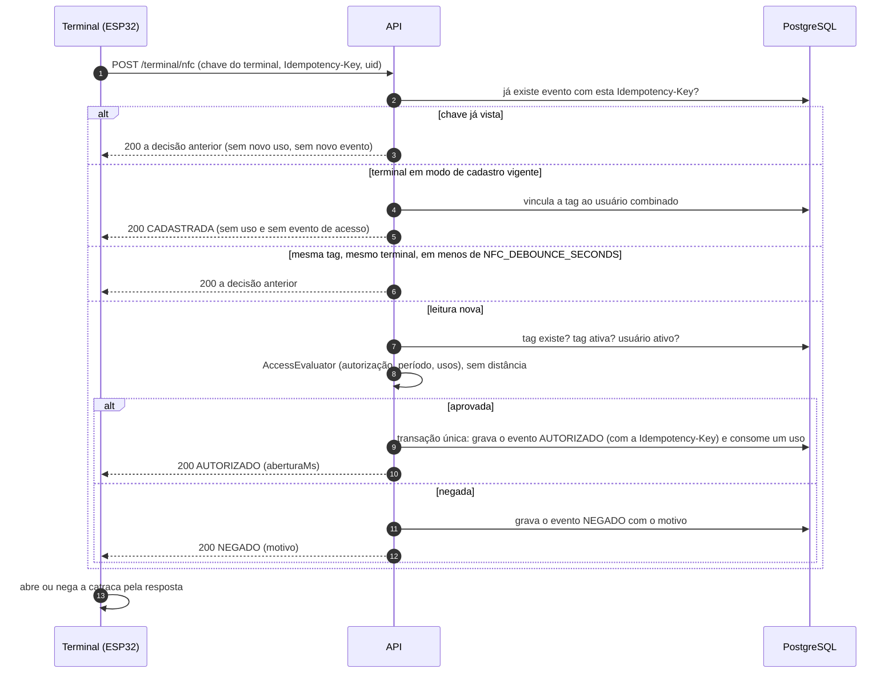
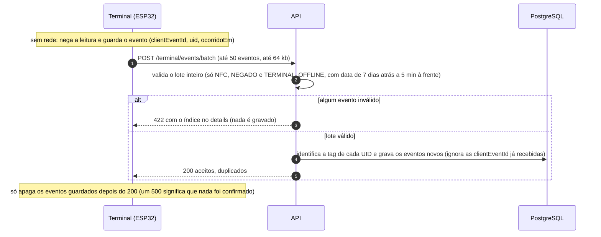

# Diagramas de sequência

Os dois fluxos de acesso do backend: **QR Code** (o app lê o QR do terminal) e **NFC** (o terminal lê a tag). Os dois usam o mesmo avaliador de autorização (`AccessEvaluator`) e gravam **exatamente um evento por tentativa**.

Contrato das rotas: [openapi.yaml](../openapi.yaml) (Swagger em `/docs`). Ordem das verificações e efeitos de uma decisão: [docs/ai/03-domain-and-contract.md](ai/03-domain-and-contract.md), seções 5.1 a 5.3.

## 1. Acesso por QR Code

O terminal pede um QR novo a cada `QR_REFRESH_MS` (10 s) e o desenha na tela. A pessoa lê o QR com o app, que envia o texto lido e a posição do celular. O backend decide, grava o evento e cria um comando para a catraca.

Pontos que o diagrama resume:

- **Atomicidade.** Na aprovação, se qualquer passo da transação falhar (inclusive o evento), nada é consumido e a resposta é `500`. Duas leituras simultâneas do mesmo QR aprovam só uma; a outra recebe `CREDENCIAL_REUTILIZADA` ou `USOS_ESGOTADOS`.
- **Negação não consome o QR.** Quem errou (por exemplo, estava longe) pode tentar de novo enquanto o QR vale.
- **Comando com prazo.** O comando só é entregue enquanto tiver até `COMMAND_TTL_SECONDS` (10 s) de vida. Depois disso, nunca mais.
- **Tempo.** O relógio do servidor decide o prazo do QR e a janela de cada autorização (fuso `America/Sao_Paulo`, limites inclusivos).

## 2. Acesso por NFC

A decisão vem **na própria resposta** do terminal (sempre `200`); não há comando nem app. Cada leitura traz um `Idempotency-Key` novo (UUID).

Pontos que o diagrama resume:

- **Idempotência.** Repetir a mesma `Idempotency-Key` (por exemplo, o terminal não recebeu a resposta e reenviou) devolve a decisão anterior. Quem decide a corrida entre dois envios simultâneos é o índice único de `clientEventId`.
- **Ordem do evento.** Na aprovação o evento é gravado antes do consumo do uso, dentro da mesma transação. Assim a repetição que corre contra o original nunca vira um falso `USOS_ESGOTADOS`.
- **Falha ao gravar.** Numa aprovação, falhar ao gravar o evento dá `500` e nenhum uso é consumido. Numa negação, a falha vai para o log e o terminal recebe `NEGADO` mesmo assim.

## 3. Eventos guardados sem conexão

Sem rede, o terminal **nega** as leituras e as guarda. Ao reconectar, envia o lote.

- Nenhum uso é consumido e nenhum comando é criado: offline o terminal só nega.
- Reenviar o mesmo lote é seguro; os já recebidos entram em `duplicados`.
