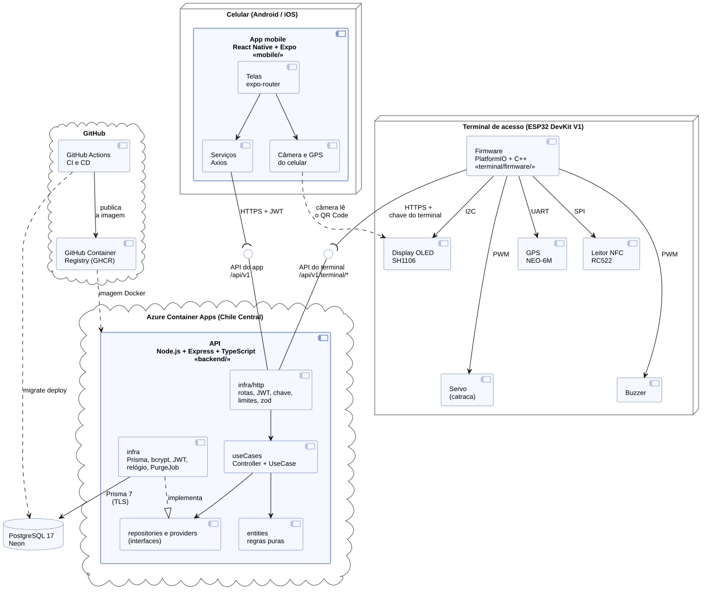

# Arquitetura do sistema

Este documento descreve o Passe inteiro (app mobile, API e terminal de acesso) e atende à RP07, que pede a
documentação e o desenho da arquitetura. Cada seção traz um resumo curto e um link para o documento que tem
o detalhe. Os nomes seguem o contrato, isto é, o [openapi.yaml](../../../backend/openapi.yaml) e o
[03-domain-and-contract.md](../../../backend/docs/ai/03-domain-and-contract.md); se este documento divergir
do contrato, vale o contrato.

A leitura completa leva cerca de 10 minutos. As seções 1 a 4 bastam para entender como o sistema funciona; as
demais servem para conferir um requisito específico.

## Sumário

1. [Visão geral e problema](#1-visão-geral-e-problema)
2. [Componentes](#2-componentes)
3. [Casos de uso](#3-casos-de-uso)
4. [Fluxos de acesso](#4-fluxos-de-acesso)
5. [Comunicação](#5-comunicação)
6. [Dados](#6-dados)
7. [Segurança](#7-segurança)
8. [Implantação](#8-implantação)
9. [Confiabilidade](#9-confiabilidade)
10. [Limitações conhecidas](#10-limitações-conhecidas)
11. [Requisitos não funcionais × seções](#11-requisitos-não-funcionais--seções)

## 1. Visão geral e problema

> **RNF:** RNF04 (usabilidade), RNF05 (manutenibilidade).

Um edifício ou condomínio quer controlar quem entra sem depender de cartão nem de porteiro. No Passe, a
pessoa chega à catraca e lê com o celular o QR Code mostrado no terminal, ou aproxima uma tag NFC do leitor.
O sistema decide em até 2 s se libera ou nega a passagem e registra toda tentativa, aprovada ou negada.

O sistema tem três partes. O **app mobile** atende o administrador, que cadastra pessoas, locais e
autorizações, e o usuário (condômino ou visitante), que lê o QR Code e consulta as próprias autorizações. A
**API** guarda os dados, gera o QR Code de cada terminal e decide cada tentativa. O **terminal de acesso**,
um ESP32 instalado na catraca, mostra o QR Code, lê a tag NFC e abre ou nega a passagem. O app e o terminal
nunca se comunicam pela rede: os dois falam só com a API. Como o público inclui pessoas idosas, o app usa
letra grande, alto contraste e no máximo 3 toques até o resultado
([relatório F14](../../app-mobile/usabilidade/relatorio-F14.md)).

| Parte | Tecnologia | Responsável | Pasta |
|---|---|---|---|
| App mobile | React Native, Expo SDK 58, TypeScript | Pedro | [mobile/](../../../mobile/) |
| API | Node.js, Express 5, TypeScript, Prisma 7 | Eduardo | [backend/](../../../backend/) |
| Banco | PostgreSQL 17 (Neon) | Eduardo | [backend/prisma/](../../../backend/prisma/) |
| Terminal de acesso | ESP32 DevKit V1, PlatformIO (C++) | Matheus | [terminal/](../../../terminal/) |

## 2. Componentes

> **RNF:** RNF05 (manutenibilidade).

As três partes separam a regra de negócio da tecnologia que a cerca. A API segue a arquitetura limpa, com
um caso de uso por pasta e dependências que apontam só para dentro (`infra/http` → `useCases` →
`entities`); o ESLint confere essa regra, e o CI falha se alguém a quebrar
([arquitetura-backend.md](../../../backend/docs/arquitetura-backend.md#2-camadas-e-regra-de-dependência)).
O app divide cada tela em Page, Model, View e Service
([01-architecture.md](../../../mobile/.claude/01-architecture.md)). O firmware separa a lógica pura do acesso
ao hardware, o que permite testar essa lógica no PC
([guia-firmware.md](../../../terminal/docs/guia-firmware.md#52-duas-camadas-lógica-pura-e-hardware)).

O papel de cada componente, a pasta em que ele está e as interfaces entre eles estão em
[componentes.md](../componentes/componentes.md).

## 3. Casos de uso

> **RNF:** RNF04 (usabilidade).

O sistema tem quatro atores: Administrador, Condômino, Visitante e Terminal de acesso. Condômino e
Visitante são especializações de Usuário, e o Administrador também é um Usuário, por isso ele pode entrar por
QR Code e por NFC como qualquer outra pessoa.

São 15 casos de uso, de UC01 a UC15. O administrador mantém usuários, locais, terminais, autorizações e tags
NFC; o usuário consulta as próprias autorizações e o próprio histórico e acessa por QR Code; o terminal
exibe o QR Code, informa posição e estado, valida a tag NFC e envia os eventos guardados sem rede. O
diagrama, as fichas e a ligação com os requisitos RF01 a RF17 estão em
[casos-de-uso.md](../casos-de-uso/casos-de-uso.md).

## 4. Fluxos de acesso

> **RNF:** RNF01 (desempenho), RNF02 (segurança).

**QR Code.** A cada 10 s o terminal pede um QR novo à API e o desenha no display. Cada QR vale 10 s, mais 5 s
de tolerância, e só pode ser usado uma vez. O app lê o QR e envia o texto lido e a posição do celular para
`POST /access/qr/validate`. A API faz 11 verificações em ordem (entre elas autorização, período, usos
restantes e distância de até 100 m), e a primeira que falhar define o motivo da negação. Em seguida, a API
grava o evento e cria o comando `ABRIR` ou `NEGAR`, que o terminal busca em `GET /terminal/commands` a cada
1 s.

**NFC.** O terminal lê o UID da tag e o envia para `POST /terminal/nfc`; a decisão (`AUTORIZADO` ou `NEGADO`
com o motivo) volta na própria resposta. A regra dos 100 m não vale para o NFC (decisão 4 do contrato). Os
dois fluxos usam o mesmo avaliador (`AccessEvaluator`) e gravam exatamente um evento por tentativa. Os
diagramas de sequência estão em [sequencias.md](../../../backend/docs/sequencias.md), e os 13 motivos de
negação, na seção 4.4 do
[contrato](../../../backend/docs/ai/03-domain-and-contract.md#44-códigos-de-negação-e-mensagens-campo-message-do-app).

## 5. Comunicação

> **RNF:** RNF02 (segurança).

Toda a comunicação usa HTTPS com JSON e, do lado do terminal, polling; o projeto não usa MQTT. As rotas
começam com `/api/v1`. O app se identifica com o JWT no cabeçalho `Authorization: Bearer`, e o terminal, com
`X-Terminal-Id` e `X-Terminal-Key` em toda chamada. Qualquer erro volta no mesmo formato:
`{ "error": { "code", "message", "details?" } }`.

| Cliente | O que faz | Rotas | Cadência |
|---|---|---|---|
| App | administra e consulta | `/auth/*`, `/users`, `/buildings`, `/access-points`, `/terminals`, `/nfc-tags`, `/authorizations`, `/access-events`, `/me/*` | a cada ação da pessoa |
| App | valida o QR Code | `POST /access/qr/validate` | a cada leitura |
| Terminal | informa posição e estado | `POST /terminal/heartbeat` | a cada 10 s |
| Terminal | pede o QR Code | `POST /terminal/qr` | a cada 10 s |
| Terminal | busca e confirma comandos | `GET /terminal/commands`, `POST /terminal/commands/{id}/ack` | a cada 1 s |
| Terminal | valida a tag NFC | `POST /terminal/nfc` | a cada leitura |
| Terminal | envia os eventos offline | `POST /terminal/events/batch` | ao reconectar |

O detalhe de cada rota está em [comunicacao.md](../../../backend/docs/comunicacao.md), e o Swagger da
homologação, em
[/docs](https://api-acesso.blackfield-72312729.chilecentral.azurecontainerapps.io/docs).

## 6. Dados

> **RNF:** RNF06 (persistência).

Os dados ficam num PostgreSQL 17 hospedado no Neon, com 9 tabelas. O esquema é definido pelas migrações do
Prisma, que ficam no repositório e são aplicadas pelo CD antes de cada publicação da API. As regras de
integridade estão em `CHECK` nas migrações, e todas as chaves estrangeiras usam `ON DELETE RESTRICT`: o
sistema desativa registros, mas nunca os apaga.

Os instantes são gravados em UTC, enquanto as datas e as horas das autorizações são avaliadas no fuso
`America/Sao_Paulo`. A tabela `access_events` só recebe inserções, porque nenhuma rota edita ou apaga um
evento. O diagrama do banco, gerado a partir do `schema.prisma` e protegido por um teste que falha quando
ele fica desatualizado, está em [modelo-de-dados.md](../../../backend/docs/modelo-de-dados.md). O
procedimento de backup está em [backup-e-restauracao.md](../../../backend/docs/backup-e-restauracao.md).

## 7. Segurança

> **RNF:** RNF02 (segurança).

O banco guarda as senhas com bcrypt e as chaves dos terminais e os tokens do QR como SHA-256, nunca em texto
puro. Os segredos ficam em variáveis de ambiente e nos secrets do GitHub e do Azure, e o gitleaks confere que
nenhum deles entrou no histórico do repositório. A API valida toda entrada com zod e limita as requisições
do login, da validação do QR, do terminal e das rotas públicas. Em produção, as respostas de erro não mostram
o rastro interno, e os logs não gravam senha, token nem chave.

No app, o JWT fica no armazenamento seguro do celular (`expo-secure-store`). No terminal, a chave fica no
`secrets.h`, que está fora do Git; quando é preciso trocá-la, o administrador usa
`POST /terminals/{id}/rotate-key` pelo app. O checklist completo, com a evidência de cada item, está em
[seguranca.md](../../../backend/docs/seguranca.md).

## 8. Implantação

> **RNF:** RNF08 (integração contínua), RNF09 (entrega contínua), RNF10 (testes automatizados),
> RNF11 (versionamento), RNF12 (monitoramento).

Cada parte tem o próprio CI no GitHub Actions, que roda em todo push e em todo PR:
[ci.yml](../../../.github/workflows/ci.yml) para a API, [mobile-ci.yml](../../../.github/workflows/mobile-ci.yml)
para o app e [terminal-ci.yml](../../../.github/workflows/terminal-ci.yml) para o firmware. Os CIs da API e do
app executam lint, verificação de tipos e testes com cobertura; o do terminal executa os testes da lógica pura
no PC e compila o firmware. Só a API soma 847 testes unitários e 804 de integração, com 100% das linhas
cobertas ([plano-de-testes.md](../../../backend/docs/plano-de-testes.md)). O ruleset
[protecao-develop-main.json](../../../.github/rulesets/protecao-develop-main.json) protege a `develop` e a
`main`, de modo que todo merge exige PR, 1 aprovação e o CI da API verde.

Quando o CI passa na `develop`, o [cd.yml](../../../.github/workflows/cd.yml) gera a imagem Docker, publica
essa imagem no GitHub Container Registry, aplica as migrações no Neon e atualiza o Azure Container Apps, na
região Chile Central, sem custo. Ao final, ele chama `GET /api/v1/health` por HTTPS e falha se a resposta não
for `ok`. Para monitorar a API, um monitor externo consulta `GET /api/v1/ready`, que responde 503 quando o
banco não responde. O passo a passo da implantação está em
[deploy-azure.md](../../../backend/docs/deploy-azure.md), e o teste ponta a ponta na homologação, em
[roteiro-teste-integrado.md](../../testes/roteiro-teste-integrado.md).

## 9. Confiabilidade

> **RNF:** RNF03 (confiabilidade), RNF07 (eficiência energética).

Sem rede, o terminal **nega** toda leitura NFC (decisão 10 do contrato), mostra `Sem conexao` e guarda o
evento numa fila na memória flash, com capacidade para 100 eventos e resistente a queda de energia. Cada
evento recebe um `clientEventId` (UUID). Quando a rede volta, o terminal envia a fila em
`POST /terminal/events/batch`, em lotes de até 20, e só apaga os eventos depois de receber `200`.

A API usa o `clientEventId` para não gravar o mesmo evento duas vezes e devolve os repetidos em
`duplicados`. Ela também recusa (`422`) qualquer evento `AUTORIZADO` no lote, porque o terminal nunca libera a
passagem sem rede. Enquanto está offline, o terminal também não mostra QR Code, já que só a API pode gerá-lo.
A API já atende o lote (etapa B19), mas a fila do terminal é a etapa I12, ainda em construção; o detalhe está
no [guia do firmware](../../../terminal/docs/guia-firmware.md#i12--offline-fila-local-e-reconexão-rnf03).
O terminal não entra em deep sleep, porque precisa da rede e do QR Code o tempo todo; as medidas de consumo
ficarão em `terminal/docs/energia.md` (etapa I13, do Matheus).

## 10. Limitações conhecidas

> **RNF:** RNF02 (segurança), RNF03 (confiabilidade).

| Limitação | Efeito | Origem |
|---|---|---|
| O UID da tag NFC é clonável. | Quem tiver uma cópia da tag entra no lugar do dono. O time aceitou esse risco. | decisão 12 do contrato |
| A API roda em uma única instância. | Os contadores de limite de requisição ficam na memória dessa instância; com duas instâncias, cada uma contaria à parte. | [arquitetura-backend.md](../../../backend/docs/arquitetura-backend.md#8-limitações-conhecidas) |
| Um terminal comprometido escolhe o UID do lote offline. | Ele pode forjar negações em nome de quem tem tag. | [seguranca.md](../../../backend/docs/seguranca.md#8-limitações-conhecidas) |
| A fila offline do terminal depende da etapa I12. | Até a I12, o terminal não guarda as tentativas feitas sem rede. | [guia-firmware.md](../../../terminal/docs/guia-firmware.md#i12--offline-fila-local-e-reconexão-rnf03) |
| O HTTPS no terminal depende da etapa I14. | Na rede local, o terminal usa HTTP para falar com a API no Docker. | [guia-firmware.md](../../../terminal/docs/guia-firmware.md#i14--segurança-do-terminal-rnf02) |
| O GPS real depende da etapa I09. | Até lá, o terminal envia coordenadas fixas com `gpsSimulado: true`. | [guia-firmware.md](../../../terminal/docs/guia-firmware.md#i09--gps-rf11) |
| O alerta de queda em até 5 minutos ainda não foi medido. | O monitor externo ainda não foi configurado. | [seguranca.md](../../../backend/docs/seguranca.md#7-monitoramento) |
| O app só tem build para Android. | Quem usa iPhone precisa abrir o app pelo Expo Go. | [mobile/README.md](../../../mobile/README.md) |

O manual do usuário do app é a etapa F15, do Pedro; o link para ele entra na revisão final (G10), quando o
manual estiver pronto.

## 11. Requisitos não funcionais × seções

| RNF | Tema | Seções |
|---|---|---|
| RNF01 | Desempenho | [4](#4-fluxos-de-acesso) |
| RNF02 | Segurança | [4](#4-fluxos-de-acesso), [5](#5-comunicação), [7](#7-segurança), [10](#10-limitações-conhecidas) |
| RNF03 | Confiabilidade | [9](#9-confiabilidade), [10](#10-limitações-conhecidas) |
| RNF04 | Usabilidade | [1](#1-visão-geral-e-problema), [3](#3-casos-de-uso) |
| RNF05 | Manutenibilidade | [1](#1-visão-geral-e-problema), [2](#2-componentes) |
| RNF06 | Persistência | [6](#6-dados) |
| RNF07 | Eficiência energética | [9](#9-confiabilidade) |
| RNF08 | Integração contínua | [8](#8-implantação) |
| RNF09 | Entrega contínua | [8](#8-implantação) |
| RNF10 | Testes automatizados | [8](#8-implantação) |
| RNF11 | Versionamento | [8](#8-implantação) |
| RNF12 | Monitoramento | [8](#8-implantação) |
