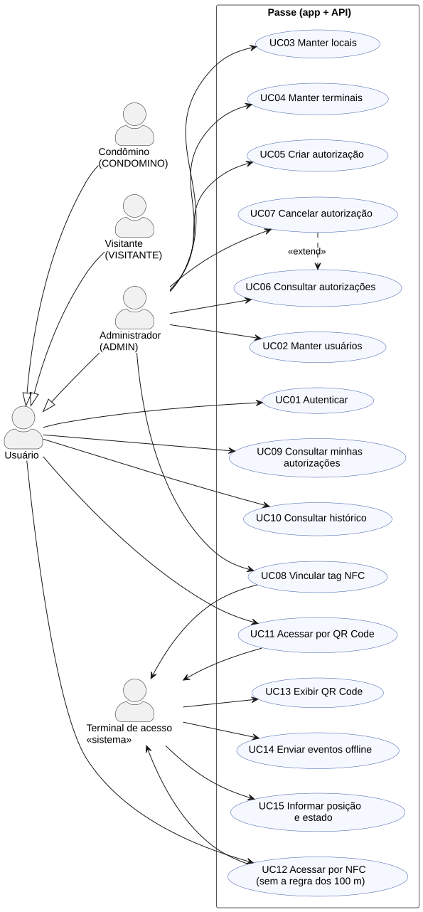

# Casos de uso

Etapa **G04** do [plano da documentação](../plano-documentacao.md). Este documento atende à RP07 ("diagramas
de casos de uso"). O contrato manda: os nomes, as rotas e os motivos vêm do
[`openapi.yaml`](../../backend/openapi.yaml) e do
[`03-domain-and-contract.md`](../../backend/docs/ai/03-domain-and-contract.md).

## Sumário

1. [Diagrama](#1-diagrama)
2. [Atores](#2-atores)
3. [Lista dos casos de uso](#3-lista-dos-casos-de-uso)
4. [Fichas](#4-fichas)
5. [Rastreabilidade](#5-rastreabilidade)

---

## 1. Diagrama



Fonte: [casos-de-uso.puml](casos-de-uso.puml). Para gerar a imagem de novo, use:

```bash
plantuml -tsvg docs/arquitetura/casos-de-uso.puml
```

## 2. Atores

| Ator | Tipo | Descrição |
|---|---|---|
| Usuário | pessoa | Uma pessoa com conta no app. Generaliza os três perfis abaixo. |
| Condômino | pessoa | Perfil `CONDOMINO`. Faz tudo que o Usuário faz. |
| Visitante | pessoa | Perfil `VISITANTE`. Faz tudo que o Usuário faz. |
| Administrador | pessoa | Perfil `ADMIN`. Faz tudo que o Usuário faz e também administra o sistema pelo app. |
| Terminal de acesso | sistema | ESP32 na catraca. Exibe o QR Code, lê a tag NFC, abre ou nega a passagem. Fala com a API por HTTPS, com a chave do terminal. |

O sistema não tem painel web: a administração é feita só pelo app (decisão 11 do contrato).

## 3. Lista dos casos de uso

| ID | Caso de uso | Ator principal | Requisitos |
|---|---|---|---|
| UC01 | Autenticar | Usuário | RF07 |
| UC02 | Manter usuários | Administrador | RF01 |
| UC03 | Manter locais | Administrador | RF02 |
| UC04 | Manter terminais | Administrador | RF02, RF11 |
| UC05 | Criar autorização | Administrador | RF03 |
| UC06 | Consultar autorizações | Administrador | RF04 |
| UC07 | Cancelar autorização | Administrador | RF05 |
| UC08 | Vincular tag NFC | Administrador | RF10 |
| UC09 | Consultar minhas autorizações | Usuário | RF08 |
| UC10 | Consultar histórico de acessos | Usuário | RF06 |
| UC11 | Acessar por QR Code | Usuário | RF09, RF13, RF15, RF16 |
| UC12 | Acessar por NFC | Usuário | RF10, RF14, RF15, RF16 |
| UC13 | Exibir QR Code | Terminal de acesso | RF12 |
| UC14 | Informar estado e posição | Terminal de acesso | RF11 |
| UC15 | Enviar eventos offline | Terminal de acesso | RNF03, RF17 |
| UC16 | Avaliar autorização | (incluído) | RF13, RF14 |
| UC17 | Registrar evento de acesso | (incluído) | RF17 |

Relações:

- UC11 e UC12 incluem UC16 e UC17.
- UC15 inclui UC17.
- UC07 estende UC06: o administrador cancela a partir da consulta.
- O Terminal de acesso participa de UC08, UC11 e UC12 como ator secundário.

---

## 4. Fichas

### UC01 — Autenticar (RF07)

- **Ator principal:** Usuário.
- **Pré-condição:** a pessoa tem uma conta ativa.
- **Fluxo principal:**
  1. A pessoa abre o app e digita o e-mail e a senha.
  2. O app envia `POST /auth/login`.
  3. A API confere a senha e devolve o token (válido por 12 h) e o perfil.
  4. O app mostra o início do perfil: administrador ou pessoa.
- **Fluxos alternativos:**
  - A1. E-mail ou senha errados: a API responde `401 CREDENCIAIS_INVALIDAS`. O app mostra o erro e não diz qual dos dois errou.
  - A2. Mais de 5 tentativas por minuto: a API responde `429 RATE_LIMITED`.
  - A3. Senha certa, mas conta inativa: `403 USUARIO_INATIVO`, com a mensagem "Seu cadastro está inativo. Procure a administração."
  - A4. A conta é desativada durante o uso: a próxima chamada dá `401` e o app volta ao login.
  - A5. O app reabre com uma sessão guardada: o app confere o token com `GET /auth/me` e vai direto ao início.

### UC02 — Manter usuários (RF01)

- **Ator principal:** Administrador.
- **Pré-condição:** o administrador está autenticado (UC01).
- **Fluxo principal:**
  1. O administrador abre **Usuários**.
  2. O administrador cria um usuário com nome, e-mail, senha e perfil (`ADMIN`, `CONDOMINO` ou `VISITANTE`).
  3. A API guarda a senha só como hash.
  4. O administrador consulta, edita, desativa ou reativa um usuário.
- **Fluxos alternativos:**
  - A1. E-mail repetido: `409 EMAIL_JA_CADASTRADO`.
  - A2. O administrador tenta desativar a própria conta: `409 AUTO_DESATIVACAO`.
  - A3. A desativação deixaria o sistema sem administrador ativo: `409 ULTIMO_ADMIN`.
- **Regra:** a API nunca apaga um usuário. Ela só desativa.

### UC03 — Manter locais (RF02)

- **Ator principal:** Administrador.
- **Pré-condição:** o administrador está autenticado.
- **Fluxo principal:**
  1. O administrador cria um edifício com nome, endereço e coordenadas.
  2. O administrador cria um ponto de acesso (portaria, porta ou catraca) no edifício, com coordenadas.
  3. Ao lado do ponto, o administrador pode usar **Usar minha localização atual** para preencher as coordenadas.
  4. O administrador edita, desativa ou reativa edifícios e pontos.
- **Fluxos alternativos:**
  - A1. O ponto, ou um ponto do edifício, tem autorização ativa: a desativação é recusada com `409 LOCAL_COM_AUTORIZACOES_ATIVAS`.

### UC04 — Manter terminais (RF02, RF11)

- **Ator principal:** Administrador.
- **Pré-condição:** o ponto de acesso existe (UC03).
- **Fluxo principal:**
  1. O administrador cria um terminal num ponto de acesso. Cada ponto tem um terminal.
  2. A API gera a chave do terminal e a mostra **uma vez**. A API guarda só o hash da chave.
  3. O administrador copia a chave e a entrega a quem grava o terminal.
  4. A lista de terminais mostra se cada terminal está online.
- **Fluxos alternativos:**
  - A1. A chave vazou ou foi perdida: o administrador gera uma nova chave (`POST /terminals/{id}/rotate-key`). A chave antiga deixa de valer na hora, e o terminal mostra `Chave invalida`.
  - A2. O administrador desativa o terminal: a API responde `403` ao terminal, e ele mostra `Terminal desativado`.

### UC05 — Criar autorização (RF03)

- **Ator principal:** Administrador.
- **Pré-condição:** a pessoa e o ponto de acesso existem e estão ativos.
- **Fluxo principal:**
  1. O administrador abre **Nova autorização**.
  2. O administrador informa a pessoa, o ponto de acesso, a data inicial e a final, o horário inicial e o final e o número de usos.
  3. A API grava a autorização com a situação `ATIVA`.
- **Fluxos alternativos:**
  - A1. Número de usos fora de 1 a 1000: `422`.
  - A2. Horário final igual ou anterior ao inicial: `422`. O horário não pode passar da meia-noite (decisão 7).
  - A3. Data final anterior à inicial: `422`.
- **Regra:** a API calcula a situação efetiva na leitura: `CANCELADA`, `EXPIRADA`, `ESGOTADA` ou `ATIVA`.

### UC06 — Consultar autorizações (RF04)

- **Ator principal:** Administrador.
- **Pré-condição:** o administrador está autenticado.
- **Fluxo principal:**
  1. O administrador abre **Autorizações**.
  2. O administrador filtra por pessoa, local, situação e período.
  3. A API devolve a lista paginada.
  4. O administrador abre o detalhe de uma autorização.
- **Fluxos alternativos:**
  - A1. Um Condômino ou Visitante chama a rota: `403`.

### UC07 — Cancelar autorização (RF05)

- **Ator principal:** Administrador.
- **Pré-condição:** a autorização existe (UC06).
- **Fluxo principal:**
  1. No detalhe da autorização, o administrador toca em **Cancelar autorização**.
  2. O administrador confirma e pode informar um motivo.
  3. A API muda a situação para `CANCELADA`. O efeito é imediato.
- **Fluxos alternativos:**
  - A1. A autorização já está cancelada: a API devolve a mesma autorização, sem erro (operação idempotente).

### UC08 — Vincular tag NFC (RF10)

- **Ator principal:** Administrador. **Ator secundário:** Terminal de acesso.
- **Pré-condição:** a pessoa existe e está ativa.
- **Fluxo principal (pelo UID):**
  1. O administrador abre **Tags NFC → Nova tag**.
  2. O administrador escolhe a pessoa e digita o UID da tag.
  3. A API normaliza o UID (tira `:`, `-` e espaços; passa para maiúsculas) e grava a tag ativa.
- **Fluxo alternativo (pelo terminal):**
  - A1. O administrador toca em **Ler tag no terminal** e escolhe a pessoa e o terminal (`POST /terminals/{id}/enroll-mode`).
  - A2. Em até 60 s, a pessoa encosta a tag no terminal.
  - A3. A API vincula a tag e responde `CADASTRADA`. O terminal mostra `Tag cadastrada` com dois bipes. Nenhum evento de acesso é gravado.
- **Fluxos de erro:**
  - E1. UID já cadastrado: `409 TAG_JA_CADASTRADA`.
  - E2. UID que não é hexadecimal de 8 a 20 caracteres: `422`.
  - E3. O administrador desativa a tag: as próximas leituras são negadas com `TAG_INATIVA` (UC12).
- **Regra:** a API nunca apaga uma tag. Ela só desativa.

### UC09 — Consultar minhas autorizações (RF08)

- **Ator principal:** Usuário.
- **Pré-condição:** a pessoa está autenticada.
- **Fluxo principal:**
  1. A pessoa abre **Minhas autorizações**.
  2. O app chama `GET /me/authorizations`.
  3. O app mostra cada autorização com o local, o período, o horário, os usos restantes e a situação.
- **Regra:** a pessoa vê só as próprias autorizações. A autorização de outra pessoa dá `404`.

### UC10 — Consultar histórico de acessos (RF06)

- **Ator principal:** Usuário.
- **Pré-condição:** a pessoa está autenticada.
- **Fluxo principal:**
  1. A pessoa abre **Meu histórico** (`GET /me/access-events`).
  2. O app mostra as tentativas da pessoa, da mais recente para a mais antiga, com o resultado e o motivo.
  3. A pessoa filtra por local, método, resultado, motivo e período.
- **Fluxos alternativos:**
  - A1. O administrador abre **Histórico** (`GET /access-events`) e vê as tentativas de todas as pessoas. Ele também filtra por pessoa e por terminal.
  - A2. Uma tentativa sem pessoa identificada (tag desconhecida) aparece só para o administrador.

### UC11 — Acessar por QR Code (RF09, RF13, RF15, RF16)

- **Ator principal:** Usuário. **Ator secundário:** Terminal de acesso.
- **Pré-condição:** o terminal está online e mostra o QR Code (UC13). A pessoa está autenticada.
- **Fluxo principal:**
  1. A pessoa toca em **Abrir catraca** e aponta a câmera para o QR Code do terminal.
  2. O app confere o formato `ACS1:` e pega a posição do celular.
  3. O app envia `POST /access/qr/validate` com o texto do QR e as coordenadas.
  4. A API avalia a tentativa (UC16) e confere a distância: no máximo 100 m do terminal.
  5. A API consome a credencial e um uso, grava o evento `AUTORIZADO` (UC17) e cria o comando `ABRIR`. Tudo numa transação.
  6. O app mostra "Acesso autorizado. Pode passar." e os usos restantes.
  7. O terminal busca o comando, mostra `ACESSO LIBERADO`, bipa uma vez e abre a catraca por 5 s.
- **Fluxos alternativos (negação, `403`):** a API grava o evento `NEGADO` (UC17). O app mostra a mensagem do contrato. Se a API sabe qual é o terminal, ela cria o comando `NEGAR`, e o terminal mostra `ACESSO NEGADO` com três bipes. A catraca não abre.

  | Motivo | Quando |
  |---|---|
  | `CREDENCIAL_INVALIDA` | o QR não existe, ou o terminal ou o ponto está inativo (sem comando ao terminal se o QR não existe) |
  | `CREDENCIAL_REUTILIZADA` | o QR já foi usado |
  | `CREDENCIAL_EXPIRADA` | passaram mais de 15 s da emissão do QR |
  | `USUARIO_INATIVO` | a conta da pessoa está inativa |
  | `SEM_AUTORIZACAO` … `USOS_ESGOTADOS` | a avaliação da autorização falha (UC16) |
  | `LOCALIZACAO_INVALIDA` | o app não enviou as coordenadas |
  | `DISTANTE_DO_TERMINAL` | a pessoa está a mais de 100 m do terminal |

- **Outros fluxos:**
  - A1. O QR não tem o formato `ACS1:`: o próprio app recusa, sem chamar a API e sem evento.
  - A2. A pessoa nega a câmera: o app explica e oferece **Abrir configurações**.
  - A3. Coordenadas fora da faixa: `422`, sem evento e sem consumir a credencial.
  - A4. Mais de 10 validações por minuto: `429 RATE_LIMITED`.
- **Regra:** uma negação não consome a credencial nem o uso.

### UC12 — Acessar por NFC (RF10, RF14, RF15, RF16)

- **Ator principal:** Usuário. **Ator secundário:** Terminal de acesso.
- **Pré-condição:** a tag está vinculada à pessoa (UC08). O terminal está online.
- **Fluxo principal:**
  1. A pessoa encosta a tag no leitor do terminal.
  2. O terminal mostra `Tag lida...` e envia o UID em `POST /terminal/nfc`, com uma `Idempotency-Key`.
  3. A API encontra a tag e a pessoa e avalia a tentativa (UC16). A regra dos 100 m não vale no NFC (decisão 4).
  4. A API grava o evento `AUTORIZADO` (UC17) e consome um uso, na mesma transação.
  5. A API responde `200` com `AUTORIZADO` e o tempo de abertura, em até 2 s.
  6. O terminal mostra `ACESSO LIBERADO`, bipa uma vez e abre a catraca por 5 s.
- **Fluxos alternativos (negação, sempre `200` com `NEGADO`):** a API grava o evento `NEGADO`. O terminal mostra `ACESSO NEGADO` com o motivo e três bipes.

  | Motivo | Quando |
  |---|---|
  | `TAG_DESCONHECIDA` | o UID não está cadastrado |
  | `TAG_INATIVA` | a tag foi desativada |
  | `USUARIO_INATIVO` | a conta da pessoa está inativa |
  | `SEM_AUTORIZACAO` … `USOS_ESGOTADOS` | a avaliação da autorização falha (UC16) |

- **Outros fluxos:**
  - A1. A mesma tag no mesmo terminal em menos de 3 s: a API devolve a decisão anterior, sem novo uso e sem novo evento.
  - A2. A mesma `Idempotency-Key` repetida: a API devolve a decisão anterior.
  - A3. O terminal está em modo de cadastro: a leitura vincula a tag (UC08, fluxo A3).
  - A4. O terminal está sem rede: ele nega na hora com `Sem conexao` e guarda a leitura (UC15).

### UC13 — Exibir QR Code (RF12)

- **Ator principal:** Terminal de acesso.
- **Pré-condição:** o terminal tem a chave certa e está ativo.
- **Fluxo principal:**
  1. O terminal pede um QR com `POST /terminal/qr`.
  2. A API gera um token aleatório, guarda só o hash e devolve o texto `ACS1:<token>`.
  3. O terminal desenha o QR no display, com a contagem.
  4. A cada 10 s (`renovarEmMs`), o terminal repete o passo 1.
- **Fluxos alternativos:**
  - A1. Sem rede ou sem resposta da API: o terminal apaga o QR e mostra `Sem Wi-Fi` ou `Sem servidor`. Ele nunca mostra um QR vencido.
  - A2. Chave errada: `401`, e o terminal mostra `Chave invalida`.
  - A3. Terminal desativado: `403`, e o terminal mostra `Terminal desativado`.
- **Regra:** o QR vale 10 s mais 5 s de tolerância e só uma vez.

### UC14 — Informar estado e posição (RF11)

- **Ator principal:** Terminal de acesso.
- **Fluxo principal:**
  1. A cada 10 s, o terminal envia `POST /terminal/heartbeat` com a posição do GPS, o estado do GPS, a versão do firmware, o sinal do Wi-Fi e os eventos pendentes.
  2. A API grava o último contato e a posição.
  3. A API devolve a hora do servidor e a configuração: tempo de troca do QR, intervalo de consulta dos comandos e tempo de abertura.
- **Fluxos alternativos:**
  - A1. Sem GPS válido ou com posição antiga (mais de 10 min): a API usa as coordenadas do ponto de acesso como referência da distância (`GPS_COM_FALLBACK`).
  - A2. Sem contato por mais de 30 s: o app mostra o terminal como offline (UC04).

### UC15 — Enviar eventos offline (RNF03, RF17)

- **Ator principal:** Terminal de acesso.
- **Pré-condição:** o terminal negou leituras NFC sem rede e as guardou (UC12, A4).
- **Fluxo principal:**
  1. A rede volta. O terminal envia as leituras guardadas em `POST /terminal/events/batch`, até 50 por lote.
  2. A API grava cada leitura como evento `NEGADO` com o motivo `TERMINAL_OFFLINE` (UC17), com o horário da leitura.
  3. A API responde `200` com o número de eventos aceitos e repetidos.
  4. O terminal apaga as leituras guardadas só depois do `200`.
- **Fluxos alternativos:**
  - A1. O terminal reenvia o mesmo lote: os eventos já gravados contam como `duplicados` e não são gravados de novo.
  - A2. Um evento do lote é inválido: a API recusa o lote inteiro com `422` e não grava nada.
  - A3. O lote tem um evento `AUTORIZADO`: `422`. O terminal nunca aprova sem rede.

### UC16 — Avaliar autorização (RF13, RF14)

Caso incluído por UC11 e UC12. A primeira verificação que falha define o motivo.

1. Existe autorização da pessoa para este ponto de acesso. Se não: `SEM_AUTORIZACAO`.
2. Existe uma autorização não cancelada. Se não: `AUTORIZACAO_CANCELADA`.
3. Uma delas vale hoje e agora, no horário de São Paulo, com os limites incluídos. Se não: `FORA_DO_PERIODO`.
4. Uma delas tem usos restantes. Se não: `USOS_ESGOTADOS`.

Se mais de uma autorização passa, a API usa a de data final mais próxima.

### UC17 — Registrar evento de acesso (RF17)

Caso incluído por UC11, UC12 e UC15.

- A API grava **exatamente um evento** por tentativa, aprovada ou negada.
- O evento guarda: data e hora (UTC), método (`QR` ou `NFC`), resultado (`AUTORIZADO` ou `NEGADO`), motivo, pessoa, autorização, ponto de acesso, terminal e distância (no QR).
- Nenhuma rota altera ou apaga um evento.
- Se a gravação de uma aprovação falha, a API responde `500` e não consome o uso. Se a gravação de uma negação falha, a API registra no log e nega mesmo assim.

Campos e casos nulos: [eventos-campos.md](../../backend/docs/eventos-campos.md).

---

## 5. Rastreabilidade

| Requisito | Casos de uso |
|---|---|
| RF01 Cadastro de usuários | UC02 |
| RF02 Cadastro de local | UC03, UC04 |
| RF03 Criação de autorização | UC05 |
| RF04 Consulta de autorizações | UC06 |
| RF05 Cancelamento | UC07 |
| RF06 Histórico | UC10 |
| RF07 Autenticação | UC01 |
| RF08 Minhas autorizações | UC09 |
| RF09 Leitura do QR | UC11 |
| RF10 Leitura da tag | UC08, UC12 |
| RF11 Terminal | UC04, UC14 |
| RF12 Geração do QR | UC13 |
| RF13 Validação por QR | UC11, UC16 |
| RF14 Validação por NFC | UC12, UC16 |
| RF15 Liberação | UC11, UC12 |
| RF16 Negação | UC11, UC12 |
| RF17 Registro do evento | UC17 (incluído por UC11, UC12 e UC15) |
| RNF03 Confiabilidade | UC12 (A4), UC15 |

Os 13 motivos de negação da seção 4.4 do contrato:

| Motivo | Caso de uso |
|---|---|
| `CREDENCIAL_INVALIDA`, `CREDENCIAL_EXPIRADA`, `CREDENCIAL_REUTILIZADA` | UC11 |
| `USUARIO_INATIVO` | UC11, UC12 |
| `SEM_AUTORIZACAO`, `AUTORIZACAO_CANCELADA`, `FORA_DO_PERIODO`, `USOS_ESGOTADOS` | UC16 (por UC11 e UC12) |
| `LOCALIZACAO_INVALIDA`, `DISTANTE_DO_TERMINAL` | UC11 |
| `TAG_DESCONHECIDA`, `TAG_INATIVA` | UC12 |
| `TERMINAL_OFFLINE` | UC15 |
