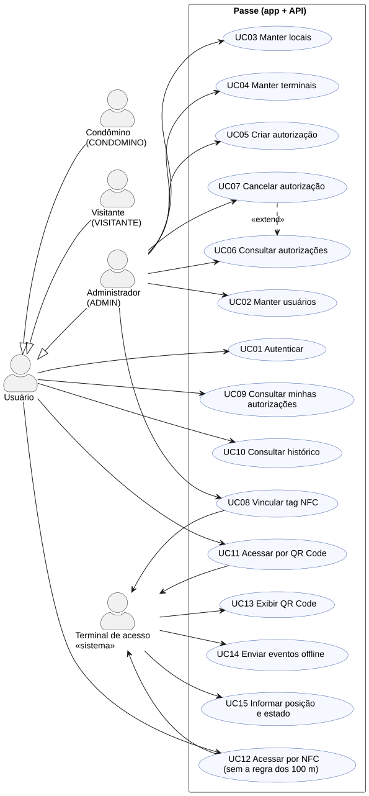

# Casos de uso

Este documento mostra quem usa o Passe e o que cada ator faz. Ele atende à RP07 (diagrama de casos de uso).
Os nomes seguem o contrato: [openapi.yaml](../../../backend/openapi.yaml) e
[03-domain-and-contract.md](../../../backend/docs/ai/03-domain-and-contract.md). Se este documento diverge do
contrato, o contrato vale.

- Fonte do diagrama: [casos-de-uso.puml](casos-de-uso.puml)
- Gere a imagem com `plantuml -tsvg docs/arquitetura/casos-de-uso/casos-de-uso.puml`.

## 1. Diagrama

## 2. Atores

| Ator | Tipo | Descrição |
|---|---|---|
| Usuário | humano, abstrato | Pessoa com conta no app. Faz login, consulta as próprias autorizações e o próprio histórico, e acessa por QR Code ou por NFC. |
| Condômino | humano | Usuário com o perfil `CONDOMINO`. Herda os casos do Usuário. |
| Visitante | humano | Usuário com o perfil `VISITANTE`. Herda os casos do Usuário. |
| Administrador | humano | Usuário com o perfil `ADMIN`. Herda os casos do Usuário e também administra o sistema pelo app. |
| Terminal de acesso | sistema | ESP32 (ou simulador) no ponto de acesso. Exibe o QR Code, lê a tag NFC, abre ou nega. Usa a chave do terminal (`X-Terminal-Id` e `X-Terminal-Key`). |

O Administrador é uma especialização do Usuário. Por isso ele também acessa por QR Code e por NFC.
A rota `POST /access/qr/validate` aceita qualquer perfil.

O limite do sistema é o app mais a API. O terminal fica fora do limite, porque é um dispositivo separado que
chama a API.

## 3. Lista dos casos de uso

| ID | Caso de uso | Ator principal | Rotas | RF |
|---|---|---|---|---|
| [UC01](#uc01--autenticar) | Autenticar | Usuário | `POST /auth/login`, `GET /auth/me` | RF07 |
| [UC02](#uc02--manter-usuários) | Manter usuários | Administrador | `/users` | RF01 |
| [UC03](#uc03--manter-locais) | Manter locais | Administrador | `/buildings`, `/access-points` | RF02 |
| [UC04](#uc04--manter-terminais) | Manter terminais | Administrador | `/terminals`, `POST /terminals/:id/rotate-key` | RF02, RF11 |
| [UC05](#uc05--criar-autorização) | Criar autorização | Administrador | `POST /authorizations` | RF03 |
| [UC06](#uc06--consultar-autorizações) | Consultar autorizações | Administrador | `GET /authorizations`, `GET /authorizations/:id` | RF04 |
| [UC07](#uc07--cancelar-autorização) | Cancelar autorização | Administrador | `PATCH /authorizations/:id/cancel` | RF05 |
| [UC08](#uc08--vincular-tag-nfc) | Vincular tag NFC | Administrador | `/nfc-tags`, `POST /terminals/:id/enroll-mode`, `POST /terminal/nfc` | RF10 |
| [UC09](#uc09--consultar-minhas-autorizações) | Consultar minhas autorizações | Usuário | `GET /me/authorizations`, `GET /authorizations/:id` | RF08 |
| [UC10](#uc10--consultar-histórico) | Consultar histórico | Usuário | `GET /me/access-events`, `GET /access-events` | RF06 |
| [UC11](#uc11--acessar-por-qr-code) | Acessar por QR Code | Usuário | `POST /access/qr/validate`, `GET /terminal/commands`, `POST /terminal/commands/:id/ack` | RF09, RF13, RF15, RF16, RF17 |
| [UC12](#uc12--acessar-por-nfc) | Acessar por NFC | Usuário | `POST /terminal/nfc` | RF14, RF15, RF16, RF17 |
| [UC13](#uc13--exibir-qr-code) | Exibir QR Code | Terminal de acesso | `POST /terminal/qr` | RF12 |
| [UC14](#uc14--enviar-eventos-offline) | Enviar eventos offline | Terminal de acesso | `POST /terminal/events/batch` | RF17 |
| [UC15](#uc15--informar-posição-e-estado) | Informar posição e estado | Terminal de acesso | `POST /terminal/heartbeat` | RF11 |

O UC15 não está na lista da G04 do [plano](../../plano-documentacao.md). Ele entrou para cobrir o RF11
(o terminal informa posição e estado).

## 4. Regras comuns a todas as fichas

- Os casos UC02 a UC10 exigem o UC01. O app envia `Authorization: Bearer <jwt>` em cada pedido.
- Um token inválido ou vencido recebe 401. O app volta para a tela de login.
- Um perfil sem permissão recebe 403 `FORBIDDEN`. Só o `ADMIN` executa os casos UC02 a UC08.
- Um dado fora do formato recebe 422 `VALIDATION_ERROR`, com um item de `details` por campo.
- Nenhum cadastro é apagado. O administrador desativa o registro com `ativo: false`.
- Os casos UC13 a UC15 exigem a chave do terminal. Uma chave errada recebe 401.

---

## 5. Fichas

### UC01 — Autenticar

- **Ator principal:** Usuário (qualquer perfil).
- **Pré-condição:** o usuário tem conta.
- **RF:** RF07.

**Fluxo principal**

1. O usuário abre o app e informa o e-mail e a senha.
2. O app envia `POST /auth/login`.
3. A API confere a senha com o hash e confere que a conta está ativa.
4. A API devolve o JWT e o perfil do usuário.
5. O app mostra as telas do perfil (`ADMIN`, `CONDOMINO` ou `VISITANTE`).

**Fluxos alternativos**

- **A1 — Credenciais erradas.** No passo 3, o e-mail não existe ou a senha está errada. A API responde 401
  `CREDENCIAIS_INVALIDAS`. A resposta é a mesma nos dois casos.
- **A2 — Conta inativa.** No passo 3, a senha está certa e a conta está inativa. A API responde 403
  `USUARIO_INATIVO`.
- **A3 — Muitas tentativas.** O usuário passa de 5 tentativas por minuto para o mesmo IP e e-mail. A API
  responde 429 `RATE_LIMITED` com `Retry-After`.

### UC02 — Manter usuários

- **Ator principal:** Administrador.
- **Pré-condição:** UC01 com o perfil `ADMIN`.
- **RF:** RF01.

**Fluxo principal**

1. O administrador abre a lista de usuários. O app envia `GET /users`.
2. O administrador cadastra um usuário com nome, e-mail, senha e perfil. O app envia `POST /users`.
3. A API grava o e-mail em minúsculas e grava a senha só como hash.
4. O administrador altera o nome, o perfil, a senha ou a situação. O app envia `PATCH /users/:id`.
5. Para tirar o acesso, o administrador envia `ativo: false`. O token do usuário perde a validade na hora.

**Fluxos alternativos**

- **A1 — E-mail repetido.** No passo 2, o e-mail já existe. A API responde 409 `EMAIL_JA_CADASTRADO`.
- **A2 — Autodesativação.** No passo 4, o administrador tenta desativar a si mesmo ou mudar o próprio
  perfil. A API responde 409 `AUTO_DESATIVACAO`.
- **A3 — Último administrador.** No passo 4, a mudança deixa o sistema sem `ADMIN` ativo. A API responde 409
  `ULTIMO_ADMIN`.

### UC03 — Manter locais

- **Ator principal:** Administrador.
- **Pré-condição:** UC01 com o perfil `ADMIN`.
- **RF:** RF02.

**Fluxo principal**

1. O administrador cadastra um edifício com nome, endereço, latitude e longitude. O app envia `POST /buildings`.
2. O administrador cadastra um ponto de acesso no edifício. O app envia `POST /access-points`.
3. O ponto de acesso tem tipo (`PORTARIA`, `PORTA` ou `CATRACA`), nome, identificação e coordenadas.
4. O administrador altera ou desativa o edifício ou o ponto de acesso com `PATCH`.

**Fluxos alternativos**

- **A1 — Identificação repetida.** No passo 2, a identificação já existe no edifício. A API responde 409 `CONFLICT`.
- **A2 — Edifício inativo.** No passo 2, o edifício está inativo. A API responde 422 no campo `buildingId`.
- **A3 — Local em uso.** No passo 4, o administrador desativa um local com autorizações ativas. A API responde
  409 `LOCAL_COM_AUTORIZACOES_ATIVAS`.

### UC04 — Manter terminais

- **Ator principal:** Administrador.
- **Pré-condição:** UC01 com o perfil `ADMIN`. O ponto de acesso existe e está ativo.
- **RF:** RF02, RF11.

**Fluxo principal**

1. O administrador cadastra um terminal para um ponto de acesso. O app envia `POST /terminals`.
2. A API gera a chave do terminal (`apiKey`) e grava só o hash dela.
3. O app mostra a chave uma vez. O responsável grava a chave no firmware.
4. O administrador consulta os terminais com `GET /terminals`. A lista mostra se cada terminal está online.
5. O administrador altera ou desativa o terminal com `PATCH /terminals/:id`.

**Fluxos alternativos**

- **A1 — Troca da chave.** A chave vazou ou foi perdida. O administrador envia
  `POST /terminals/:id/rotate-key`. A API gera uma chave nova e invalida a antiga na hora.
- **A2 — Ponto já tem terminal.** No passo 1, o ponto de acesso já tem um terminal. A API responde 409 `CONFLICT`.
- **A3 — Ponto inativo.** No passo 1, o ponto de acesso está inativo. A API responde 422 no campo `accessPointId`.

### UC05 — Criar autorização

- **Ator principal:** Administrador.
- **Pré-condição:** UC01 com o perfil `ADMIN`. O usuário e o ponto de acesso existem e estão ativos.
- **RF:** RF03.

**Fluxo principal**

1. O administrador escolhe a pessoa e o ponto de acesso.
2. O administrador informa a data de início, a data de fim, a hora de início, a hora de fim e o número de usos.
3. O app envia `POST /authorizations`.
4. A API grava a autorização com a situação `ATIVA` e `usosRealizados` igual a 0.
5. A API devolve a autorização com `usosRestantes` e `situacaoEfetiva`.

**Fluxos alternativos**

- **A1 — Período inválido.** `dataFim` está antes de `dataInicio` ou no passado. A API responde 422.
- **A2 — Horário inválido.** `horaFim` não está depois de `horaInicio`. A API responde 422. O horário não
  atravessa a meia-noite (decisão 7 do contrato).
- **A3 — Usos inválidos.** `usosPermitidos` não é um inteiro de 1 a 1000. A API responde 422.
- **A4 — Pessoa ou local inativo.** A API responde 422 no campo `usuarioId` ou `accessPointId`.

### UC06 — Consultar autorizações

- **Ator principal:** Administrador.
- **Pré-condição:** UC01 com o perfil `ADMIN`.
- **RF:** RF04.

**Fluxo principal**

1. O administrador abre a lista de autorizações.
2. O administrador filtra por pessoa, local, situação ou período.
3. O app envia `GET /authorizations` com os filtros e a página.
4. A API devolve a página com a situação efetiva de cada autorização: `ATIVA`, `EXPIRADA`, `ESGOTADA` ou `CANCELADA`.
5. O administrador abre o detalhe de uma autorização com `GET /authorizations/:id`.

**Fluxos alternativos**

- **A1 — Nenhum resultado.** A API devolve `data` vazio. O app mostra a lista vazia.
- **A2 — Cancelar.** No passo 5, o administrador cancela a autorização. Continue no UC07 (`<<extend>>`).

### UC07 — Cancelar autorização

- **Ator principal:** Administrador.
- **Pré-condição:** UC01 com o perfil `ADMIN`. A autorização existe.
- **RF:** RF05.

**Fluxo principal**

1. O administrador abre a autorização (UC06) e escolhe "Cancelar".
2. O administrador informa um motivo opcional, com até 200 caracteres.
3. O app envia `PATCH /authorizations/:id/cancel`.
4. A API grava a situação `CANCELADA`, quem cancelou e quando.
5. A próxima tentativa de acesso com esta autorização é negada com `AUTORIZACAO_CANCELADA`.

**Fluxos alternativos**

- **A1 — Já cancelada.** A autorização já está cancelada. A API responde 200 com o estado atual e não muda
  os dados do primeiro cancelamento.

### UC08 — Vincular tag NFC

- **Ator principal:** Administrador.
- **Ator secundário:** Terminal de acesso (só no fluxo A1).
- **Pré-condição:** UC01 com o perfil `ADMIN`. O usuário existe e está ativo.
- **RF:** RF10.

**Fluxo principal (pelo UID)**

1. O administrador escolhe o usuário e digita o UID da tag.
2. O app envia `POST /nfc-tags` com `usuarioId`, `uid` e uma descrição opcional.
3. A API normaliza o UID (hexadecimal, maiúsculo, sem separadores) e grava a tag ativa.
4. Para desativar a tag, o administrador envia `PATCH /nfc-tags/:id` com `ativa: false`.

**Fluxos alternativos**

- **A1 — Modo de cadastro do terminal.**
  1. O administrador escolhe o usuário e o terminal. O app envia `POST /terminals/:id/enroll-mode`.
  2. A API liga o modo de cadastro por 60 s (`ENROLL_MODE_SECONDS`).
  3. O usuário aproxima a tag do terminal. O terminal envia `POST /terminal/nfc`.
  4. A API vincula a tag ao usuário, gasta o modo e responde `CADASTRADA`. Não há evento nem consumo de uso.
- **A2 — UID repetido.** O UID já pertence a uma tag. A API responde 409 `TAG_JA_CADASTRADA`.
- **A3 — UID inválido.** O UID não tem de 8 a 20 caracteres hexadecimais. A API responde 422 no campo `uid`.
- **A4 — Modo vencido.** O usuário aproxima a tag depois dos 60 s. O terminal trata a leitura como UC12.

### UC09 — Consultar minhas autorizações

- **Ator principal:** Usuário (qualquer perfil).
- **Pré-condição:** UC01.
- **RF:** RF08.

**Fluxo principal**

1. O usuário abre "Minhas autorizações".
2. O app envia `GET /me/authorizations`.
3. A API devolve só as autorizações do dono do token. A que vence primeiro fica no topo.
4. O app mostra o local, o período, o horário, os usos restantes e a situação efetiva.
5. O usuário abre o detalhe com `GET /authorizations/:id`.

**Fluxos alternativos**

- **A1 — Autorização de outra pessoa.** No passo 5, o `id` é de outro usuário. A API responde 404. A API não
  revela que a autorização existe.
- **A2 — Nenhuma autorização.** A API devolve `data` vazio. O app mostra a lista vazia.

### UC10 — Consultar histórico

- **Ator principal:** Usuário (qualquer perfil).
- **Pré-condição:** UC01.
- **RF:** RF06.

**Fluxo principal**

1. O usuário abre o histórico.
2. O usuário filtra por local, terminal, método, resultado, motivo ou período.
3. O app envia `GET /me/access-events`.
4. A API devolve só os eventos do dono do token, do mais recente para o mais antigo.
5. O app mostra a data, o local, o método (`QR` ou `NFC`), o resultado e o motivo da negação.

**Fluxos alternativos**

- **A1 — Histórico de todos.** O ator é o Administrador. O app envia `GET /access-events`. A API devolve os
  eventos de todos os usuários e aceita também o filtro `usuarioId`.
- **A2 — Evento sem pessoa.** A tentativa usou uma tag desconhecida. O evento aparece só para o
  administrador, com `usuario` igual a `null`.

### UC11 — Acessar por QR Code

- **Ator principal:** Usuário (qualquer perfil, inclusive o Administrador).
- **Ator secundário:** Terminal de acesso.
- **Pré-condição:** UC01. O terminal exibe um QR Code válido (UC13). O GPS do celular está ligado.
- **RF:** RF09, RF13, RF15, RF16, RF17.

**Fluxo principal**

1. O usuário abre o leitor de QR Code no app.
2. O usuário aponta a câmera para o QR Code do terminal.
3. O app lê o payload `ACS1:<token>` e a posição do celular.
4. O app envia `POST /access/qr/validate` com o payload, a latitude e a longitude.
5. A API faz as 11 verificações da seção 5.1 do contrato, na ordem.
6. A API consome a credencial e um uso, grava o evento `AUTORIZADO` e cria o comando `ABRIR`. Os quatro passos usam uma só transação.
7. O app mostra "Acesso autorizado. Pode passar."
8. O terminal busca o comando com `GET /terminal/commands` (a cada 1 s).
9. O terminal abre por 5 s, toca o sinal de sucesso e confirma com `POST /terminal/commands/:id/ack`.

**Fluxos alternativos (negação)**

Em cada negação, a API grava um evento `NEGADO` com o motivo. A API responde 403 com o código e a mensagem
da seção 4.4 do contrato. O app mostra a mensagem. Se a API identificou o terminal, ela também cria o
comando `NEGAR`, e o terminal mostra a negação. O QR Code não é consumido numa negação.

| Fluxo | Passo | Condição | Motivo |
|---|---|---|---|
| A1 | 5 | O token não existe, ou o terminal ou o ponto de acesso está inativo. | `CREDENCIAL_INVALIDA` |
| A2 | 5 | A credencial já foi usada. | `CREDENCIAL_REUTILIZADA` |
| A3 | 5 | A credencial passou de 15 s (10 s mais 5 s de tolerância). | `CREDENCIAL_EXPIRADA` |
| A4 | 5 | O usuário está inativo. | `USUARIO_INATIVO` |
| A5 | 5 | O usuário não tem autorização para este ponto de acesso. | `SEM_AUTORIZACAO` |
| A6 | 5 | Todas as autorizações para este ponto estão canceladas. | `AUTORIZACAO_CANCELADA` |
| A7 | 5 | Nenhuma autorização vale nesta data e neste horário (São Paulo). | `FORA_DO_PERIODO` |
| A8 | 5 | Nenhuma autorização vigente tem usos restantes. | `USOS_ESGOTADOS` |
| A9 | 5 | O app não enviou a latitude e a longitude. | `LOCALIZACAO_INVALIDA` |
| A10 | 5 | O celular está a mais de 100 m do terminal (`MAX_DISTANCE_M`). | `DISTANTE_DO_TERMINAL` |

**Outros fluxos alternativos**

- **A11 — Coordenadas fora da faixa.** A latitude ou a longitude não é um número válido. A API responde 422
  `VALIDATION_ERROR`. Não há evento e a credencial não é consumida.
- **A12 — Leituras simultâneas.** Dois celulares leem o mesmo QR Code. A API aprova só a primeira leitura.
  A segunda recebe `CREDENCIAL_REUTILIZADA`.
- **A13 — Comando vencido.** O terminal não busca o comando em até 10 s. A API não entrega o comando, e o
  terminal não abre.
- **A14 — Muitas leituras.** O usuário passa de 10 validações por minuto. A API responde 429 `RATE_LIMITED`.

### UC12 — Acessar por NFC

- **Ator principal:** Usuário (qualquer perfil, inclusive o Administrador).
- **Ator secundário:** Terminal de acesso.
- **Pré-condição:** o usuário tem uma tag vinculada (UC08). O terminal está online.
- **RF:** RF14, RF15, RF16, RF17.

**Fluxo principal**

1. O usuário aproxima a tag do leitor RC522 do terminal.
2. O terminal lê o UID e cria um `Idempotency-Key` novo.
3. O terminal envia `POST /terminal/nfc` com o UID.
4. A API confere a tag, o usuário e a autorização (seção 5.2 do contrato). A API não aplica a regra dos 100 m (decisão 4).
5. A API grava o evento `AUTORIZADO` e consome um uso, na mesma transação.
6. A API responde 200 com `AUTORIZADO` e `aberturaMs`, em até 2 s.
7. O terminal abre por 5 s e toca o sinal de sucesso.

**Fluxos alternativos (negação)**

Em cada negação, a API grava um evento `NEGADO` e responde 200 com `NEGADO` e o motivo. O terminal mostra
a negação e toca o sinal de erro. A API não cria comando: o terminal age pela resposta.

| Fluxo | Passo | Condição | Motivo |
|---|---|---|---|
| A1 | 4 | Nenhuma tag tem este UID. | `TAG_DESCONHECIDA` |
| A2 | 4 | A tag está desativada. | `TAG_INATIVA` |
| A3 | 4 | O dono da tag está inativo. | `USUARIO_INATIVO` |
| A4 | 4 | O usuário não tem autorização para este ponto de acesso. | `SEM_AUTORIZACAO` |
| A5 | 4 | Todas as autorizações para este ponto estão canceladas. | `AUTORIZACAO_CANCELADA` |
| A6 | 4 | Nenhuma autorização vale nesta data e neste horário (São Paulo). | `FORA_DO_PERIODO` |
| A7 | 4 | Nenhuma autorização vigente tem usos restantes. | `USOS_ESGOTADOS` |

**Outros fluxos alternativos**

- **A8 — Leitura repetida.** A mesma tag passa no mesmo terminal em menos de 3 s (`NFC_DEBOUNCE_SECONDS`).
  A API devolve a decisão anterior, sem novo uso e sem novo evento.
- **A9 — Reenvio.** O terminal reenvia o mesmo `Idempotency-Key`. A API devolve a decisão anterior.
- **A10 — Modo de cadastro ligado.** O terminal está em modo de cadastro. Continue no UC08, fluxo A1.
- **A11 — Terminal sem rede.** O terminal não alcança a API. O terminal nega a leitura e guarda o evento com
  o motivo `TERMINAL_OFFLINE`. Continue no UC14 quando a rede voltar (decisão 10).

### UC13 — Exibir QR Code

- **Ator principal:** Terminal de acesso.
- **Pré-condição:** o terminal está cadastrado (UC04) e tem a chave no firmware. O terminal tem rede.
- **RF:** RF12.

**Fluxo principal**

1. O terminal envia `POST /terminal/qr` com a chave do terminal.
2. A API gera um token de 16 bytes e grava só o SHA-256 dele.
3. A API devolve o payload `ACS1:<token>`, `expiraEm` e `renovarEmMs` (10 s).
4. O terminal mostra o QR Code no display OLED.
5. Depois de 10 s, o terminal repete o passo 1.

**Fluxos alternativos**

- **A1 — Pedido antes de 5 s.** O terminal pede um QR Code antes de 5 s (`QR_ISSUE_MIN_INTERVAL_S`). A API
  responde 429 e não emite QR Code. O terminal mantém o QR Code atual.
- **A2 — Terminal sem rede.** O terminal não recebe um QR Code novo. Depois de `expiraEm`, o terminal tira o
  QR Code da tela e mostra `Sem servidor`.
- **A3 — Chave inválida.** A chave foi trocada (UC04, A1). A API responde 401. O terminal mostra `Chave invalida` e
  tenta de novo a cada 60 s.

### UC14 — Enviar eventos offline

- **Ator principal:** Terminal de acesso.
- **Pré-condição:** o terminal negou leituras sem rede (UC12, A11). A rede voltou.
- **RF:** RF17.

**Fluxo principal**

1. O terminal junta os eventos guardados em lotes de 1 a 50.
2. Cada evento tem `clientEventId`, `metodo` `NFC`, o UID, `ocorridoEm`, `resultado` `NEGADO` e `motivo` `TERMINAL_OFFLINE`.
3. O terminal envia `POST /terminal/events/batch`.
4. A API grava cada evento novo no histórico, no instante em que ele ocorreu.
5. A API responde 200 com `aceitos` e `duplicados`.
6. O terminal apaga os eventos enviados.

**Fluxos alternativos**

- **A1 — Evento repetido.** A `clientEventId` já existe. A API não grava o evento de novo e soma 1 em `duplicados`.
- **A2 — Lote inválido.** Um evento tem `resultado` `AUTORIZADO`, outro método, outro motivo ou data fora da
  faixa (7 dias antes a 5 min depois). A API responde 422 e não grava nada.
- **A3 — Lote grande.** O corpo passa de 64 kb. A API responde 413 `PAYLOAD_TOO_LARGE`.
- **A4 — Falha no envio.** A API não responde 200. O terminal guarda os eventos e envia o mesmo lote de novo.

### UC15 — Informar posição e estado

- **Ator principal:** Terminal de acesso.
- **Pré-condição:** o terminal está cadastrado (UC04) e tem rede.
- **RF:** RF11.

**Fluxo principal**

1. A cada 10 s, o terminal envia `POST /terminal/heartbeat`.
2. O corpo tem a posição do GPS, `gpsFix`, `gpsSimulado`, o firmware, o sinal do Wi-Fi e os eventos pendentes.
3. A API grava o contato com o relógio do servidor.
4. A API devolve `serverTime` e a configuração (`qrRefreshMs`, `commandPollMs`, `aberturaMs`).
5. O app mostra o terminal online ao administrador (UC04) por 30 s depois do contato.

**Fluxos alternativos**

- **A1 — GPS sem sinal.** `gpsFix` é falso. A API ignora as coordenadas e mantém a última posição. A regra dos
  100 m usa as coordenadas do ponto de acesso (`GPS_COM_FALLBACK`, decisão 2).
- **A2 — Heartbeat antes de 2 s.** A API responde 429 e não grava o contato.

---

## 6. Rastreabilidade

### 6.1 Requisitos funcionais × casos de uso

| RF | Casos de uso |
|---|---|
| RF01 Cadastro de usuários | UC02 |
| RF02 Locais de acesso | UC03, UC04 |
| RF03 Criar autorização | UC05 |
| RF04 Consultar autorizações | UC06 |
| RF05 Cancelar autorização | UC07 |
| RF06 Histórico | UC10 |
| RF07 Autenticação | UC01 |
| RF08 Minhas autorizações | UC09 |
| RF09 Leitura do QR Code | UC11 |
| RF10 Tags NFC | UC08 |
| RF11 Terminal | UC04, UC15 |
| RF12 QR Code | UC13 |
| RF13 Validação por QR Code | UC11 |
| RF14 Validação por NFC | UC12 |
| RF15 Liberação | UC11, UC12 |
| RF16 Negação | UC11, UC12 |
| RF17 Registro do evento | UC11, UC12, UC14 |

### 6.2 Motivos de negação × fluxos alternativos

Os 13 motivos da seção 4.4 do contrato aparecem nestes fluxos:

| Motivo | Fluxo |
|---|---|
| `CREDENCIAL_INVALIDA` | UC11 A1 |
| `CREDENCIAL_EXPIRADA` | UC11 A3 |
| `CREDENCIAL_REUTILIZADA` | UC11 A2, A12 |
| `USUARIO_INATIVO` | UC11 A4, UC12 A3 (e UC01 A2, no login) |
| `SEM_AUTORIZACAO` | UC11 A5, UC12 A4 |
| `AUTORIZACAO_CANCELADA` | UC11 A6, UC12 A5 |
| `FORA_DO_PERIODO` | UC11 A7, UC12 A6 |
| `USOS_ESGOTADOS` | UC11 A8, UC12 A7 |
| `DISTANTE_DO_TERMINAL` | UC11 A10 |
| `LOCALIZACAO_INVALIDA` | UC11 A9 |
| `TAG_DESCONHECIDA` | UC12 A1 |
| `TAG_INATIVA` | UC12 A2 |
| `TERMINAL_OFFLINE` | UC12 A11, UC14 |

## 7. Documentos relacionados

- [Diagramas de sequência](../../../backend/docs/sequencias.md): QR, NFC e eventos offline, passo a passo.
- [Comunicação entre os elementos](../../../backend/docs/comunicacao.md): protocolos e autenticação.
- [Campos dos eventos](../../../backend/docs/eventos-campos.md): o que cada evento guarda.
