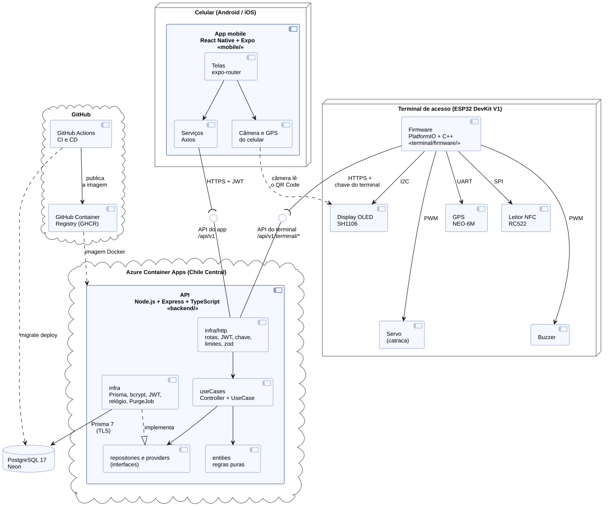

# Diagrama de componentes

Este documento mostra as partes do Passe e as interfaces entre elas. Ele atende à RP07 (diagrama de
componentes). Os nomes seguem o contrato: [openapi.yaml](../../../backend/openapi.yaml) e
[03-domain-and-contract.md](../../../backend/docs/ai/03-domain-and-contract.md). Se este documento diverge do
contrato, o contrato vale.

- Fonte do diagrama: [componentes.puml](componentes.puml)
- Gere a imagem com `plantuml -tsvg docs/arquitetura/componentes/componentes.puml`.

## 1. Diagrama

Como ler o diagrama:

- Uma caixa com o ícone de componente é uma parte do sistema.
- Um nó (caixa 3D) ou uma nuvem é o lugar onde a parte executa.
- O círculo é uma interface que a API oferece. O semicírculo marca o cliente que usa a interface.
- A linha cheia é uma chamada ou uma dependência. A linha tracejada não é uma chamada de rede.

## 2. Componentes

| Componente | O que faz | Executa em | Pasta |
|---|---|---|---|
| App mobile | Mostra as telas do administrador e do usuário. Lê o QR Code com a câmera e envia a posição do celular para a API. | celular (Android ou iOS) | [mobile/](../../../mobile/) |
| Telas | Define as rotas de tela com o expo-router. | app mobile | [mobile/src/app/](../../../mobile/src/app/) |
| Serviços | Chama a API com o Axios e envia o JWT em cada chamada. | app mobile | [mobile/src/service/](../../../mobile/src/service/) |
| Câmera e GPS do celular | Leem o QR Code (`expo-camera`) e a posição do celular (`expo-location`). | app mobile | [mobile/src/service/](../../../mobile/src/service/) |
| API | Gera o QR Code, decide cada tentativa, registra um evento por tentativa e cria o comando do terminal. | Azure Container Apps | [backend/](../../../backend/) |
| `infra/http` | Recebe a requisição. Confere o JWT ou a chave do terminal, os limites de requisição e a entrada (zod). | API | [backend/src/infra/http/](../../../backend/src/infra/http/) |
| `useCases` | Executa um caso de uso por pasta (Controller e UseCase). | API | [backend/src/useCases/](../../../backend/src/useCases/) |
| `entities` | Guarda as entidades e as regras puras, por exemplo o `AccessEvaluator`. | API | [backend/src/entities/](../../../backend/src/entities/) |
| `repositories` e `providers` | Definem as interfaces que os casos de uso usam: banco, hash, token e relógio. | API | [backend/src/repositories/](../../../backend/src/repositories/), [backend/src/providers/](../../../backend/src/providers/) |
| `infra` | Implementa as interfaces: Prisma, bcrypt, JWT e relógio do sistema. O `PurgeJob` apaga QR e comandos vencidos a cada minuto. | API | [backend/src/infra/](../../../backend/src/infra/) |
| PostgreSQL 17 (Neon) | Guarda os dados. As migrações do Prisma definem o esquema. | Neon (nuvem) | [backend/prisma/](../../../backend/prisma/) |
| Firmware | Pede o QR Code, lê a tag NFC, busca os comandos, aciona a catraca e guarda os eventos sem rede. | ESP32 DevKit V1 | [terminal/firmware/](../../../terminal/firmware/) |
| Display OLED | Mostra o QR Code e as mensagens do terminal. | terminal | [terminal/docs/pinagem.md](../../../terminal/docs/pinagem.md) |
| Leitor NFC RC522 | Lê o UID da tag NFC. | terminal | [terminal/docs/pinagem.md](../../../terminal/docs/pinagem.md) |
| GPS NEO-6M | Informa a posição do terminal. Sem o GPS, o firmware usa as coordenadas fixas do `secrets.h`. | terminal | [terminal/docs/pinagem.md](../../../terminal/docs/pinagem.md) |
| Servo | Abre e fecha a catraca. | terminal | [terminal/docs/pinagem.md](../../../terminal/docs/pinagem.md) |
| Buzzer | Emite 1 bipe de 300 ms na liberação e 3 bipes de 150 ms na negação. | terminal | [terminal/docs/pinagem.md](../../../terminal/docs/pinagem.md) |
| GitHub Actions | Executa o CI de cada parte e o CD da API. | GitHub | [.github/workflows/](../../../.github/workflows/) |
| GitHub Container Registry | Guarda a imagem Docker da API. | GitHub | [backend/Dockerfile](../../../backend/Dockerfile) |

## 3. Interfaces

O sistema usa HTTP com polling. Ele não usa MQTT. O app e o terminal não se comunicam pela rede: o app lê o
QR Code na tela do terminal com a câmera.

| De → para | Interface | Protocolo | Autenticação | Rotas (`openapi.yaml`) |
|---|---|---|---|---|
| App → API | API do app (`/api/v1`) | HTTPS, JSON | JWT (`Authorization: Bearer`) | `/auth/*`, `/users`, `/buildings`, `/access-points`, `/terminals`, `/nfc-tags`, `/authorizations`, `/access/qr/validate`, `/access-events`, `/me/authorizations`, `/me/access-events` |
| Terminal → API | API do terminal (`/api/v1/terminal/*`) | HTTPS, JSON, polling | chave do terminal (`X-Terminal-Id` e `X-Terminal-Key`) | `/terminal/heartbeat`, `/terminal/qr`, `/terminal/nfc`, `/terminal/commands`, `/terminal/commands/{id}/ack`, `/terminal/events/batch` |
| API → banco | Prisma 7 | PostgreSQL com TLS (`sslmode=require`) | usuário e senha do Neon, em secret do Azure | — |
| Celular → terminal | leitura do QR Code | câmera (sem rede) | — | — |
| Firmware → periféricos | barramentos do ESP32 | I2C (OLED), SPI (RC522), UART (GPS), PWM (servo e buzzer) | — | — |
| GitHub Actions → Azure | CD da API | imagem Docker no GHCR e `az containerapp update` | OIDC, sem senha guardada | — |
| GitHub Actions → banco | migrações | `prisma migrate deploy` | URL direta do Neon, em secret do GitHub | — |

As rotas `/health` e `/ready` são públicas e servem para monitorar a API. O detalhe de cada rota está em
[comunicacao.md](../../../backend/docs/comunicacao.md) e no Swagger (`/docs`).

O terminal recebe a decisão do QR Code pelo polling de `GET /terminal/commands`. A decisão do NFC chega na
resposta do próprio `POST /terminal/nfc`. Os passos estão em
[sequencias.md](../../../backend/docs/sequencias.md).

## 4. Limitações

- O HTTPS no terminal é a etapa I14 do guia do firmware. Na rede local, o terminal usa HTTP para a API no
  Docker.
- O GPS real é a etapa I09. Até lá, o terminal envia as coordenadas fixas com `gpsSimulado: true`.
- A API executa em uma instância. Os limites de requisição ficam na memória dessa instância
  ([arquitetura-backend.md](../../../backend/docs/arquitetura-backend.md#8-limitações-conhecidas)).
