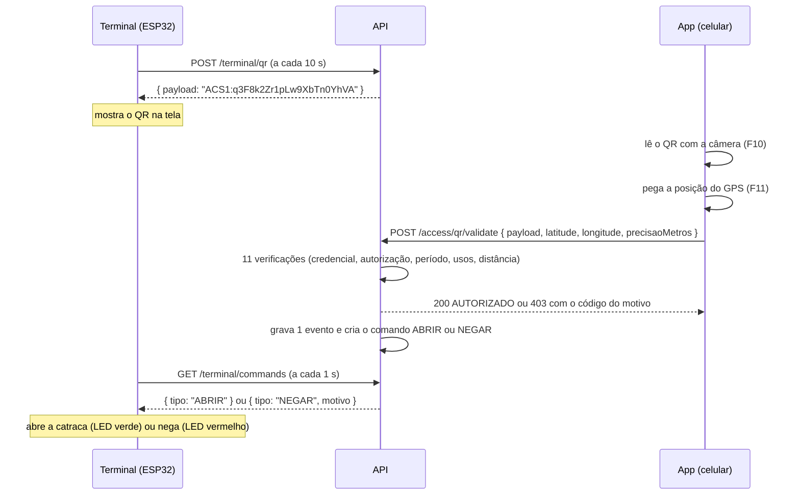

# 00 — Onboarding: o projeto e o app

Para: **Pedro** (app mobile, desde 28/10/2026). Leia este arquivo inteiro antes de escrever código: ele explica o projeto todo em 15 minutos. Situação em 28/10: **nada do app existe**; as etapas começam do zero.

Legenda: 📄 exigência do documento oficial do desafio · 💡 decisão ou sugestão do time (pode mudar) · ★ entrega que destrava outra pessoa · ❓ pergunta em aberto (lista no [STATUS.md](STATUS.md)) · 🔴 essencial · 🟡 importante · 🟢 pode ser cortada se faltar tempo.

---

## 1. Como usar estes documentos

Os documentos do app ficam em `mobile/docs/ai/`, um por responsabilidade, no mesmo formato dos do backend (`backend/docs/ai/01` a `07`):

| Arquivo | O que tem | Quando abrir |
|---|---|---|
| `00-onboarding.md` | Este arquivo: o projeto todo, as pessoas, o fluxo do QR, regras de negócio, Scrum | Primeiro dia; sempre que algo do projeto não fizer sentido |
| `../ambiente-dev.md` | Instalar, subir o backend, rodar o app no celular com o Expo Go | Antes da F01 |
| `01-architecture.md` | Arquitetura do estudos_dpi adaptada ao Expo, pastas, exemplo completo do login, regras de código | Ao criar qualquer tela, serviço ou componente |
| `02-tdd-workflow.md` | Ciclo TDD, como testar cada camada, Definição de pronto comum | Ao escrever testes e ao fechar uma etapa |
| `03-contract-for-the-app.md` | Rotas que o app usa, formato de erro, códigos de negação com texto, tom e botão | Ao mexer em serviço, erro ou tela de resultado |
| `04-steps-F01-F04.md` | Setup, tema e componentes, login, navegação | Etapas F01 a F04 |
| `05-steps-F09-F11.md` | Leitor de QR, validação e resultado, minhas autorizações | Etapas F09 a F11 |
| `06-steps-F05-F08.md` | Usuários, locais e terminais, autorizações | Etapas F05 a F08 |
| `07-steps-F12-F15.md` | Tags NFC, histórico, acessibilidade, build e manual | Etapas F12 a F15 |
| `08-commits-and-prs.md` | Branches, commits e PRs no padrão do Eduardo (em inglês, para a IA, mas vale para você também) | Ao commitar e abrir PR |
| `STATUS.md` | Ordem e prazos das etapas, situação de cada uma, marcos, perguntas em aberto | No começo e no fim de cada sessão |
| `../../AGENTS.md` | Regras para assistentes de IA (Claude, Copilot) que trabalharem no app | Se usar IA |

Roteiro:

1. Leia este arquivo inteiro e monte o ambiente pelo `ambiente-dev.md`.
2. Leia o `01-architecture.md` com calma: todas as telas seguem o mesmo molde, e o exemplo do login é o modelo para as outras 30.
3. Faça as etapas na ordem do `STATUS.md`. Para cada uma: leia **Objetivo**, **Depende de** e **Telas**; abra as telas no Figma; escreva primeiro os testes da **Lista de testes**; depois o código; depois teste no celular.
4. A etapa só fecha quando os **Critérios de aceitação** e a **Definição de pronto** (da etapa e a comum, no `02-tdd-workflow.md`) estão marcados **com evidência** (print, GIF ou vídeo curto do celular).
5. Uma etapa = uma branch = um PR (`08-commits-and-prs.md`).
6. **O contrato é lei.** Rotas, campos, status HTTP e códigos de motivo vêm do contrato. Se uma tela pedir algo que o contrato não tem, **não invente**: anote como ❓ no `STATUS.md` e fale com o Eduardo.

**Quando dois documentos discordam:** (1) contrato (`backend/docs/ai/03-domain-and-contract.md` e `backend/openapi.yaml`); (2) Figma e `tokens.md` para visual e textos; (3) estes documentos.

---

## 2. O projeto em 15 minutos

### 2.1 O que estamos construindo

Um **sistema de controle de acesso de baixo custo** para edifícios (ABP 2026-2, Fatec Jacareí, 4º DSM). O cenário do desafio: num edifício comercial, a pessoa só chega ao elevador social depois de passar por uma catraca, e a catraca só abre depois que o sistema confirma que ela pode entrar.

Há **duas formas de passar** pela catraca:

- **QR Code (o fluxo principal, e é o seu):** a catraca tem um terminal com uma tela que mostra um QR Code que muda a cada 10 s. A pessoa abre o app, lê o QR com a câmera, o app manda o QR e a posição do celular para o servidor, o servidor decide e manda o terminal abrir ou negar. O app mostra o resultado.
- **Tag NFC:** a pessoa encosta uma tag (chaveiro ou cartão) no terminal. **O app não lê NFC**: quem lê é o terminal. O app só serve para o administrador **vincular** a tag a uma pessoa.

📄 O app também é a **ferramenta do administrador**. Não existe painel web: usuários, locais, terminais, autorizações, tags e histórico são cadastrados e consultados no celular.

📄 O público inclui **pessoas idosas** (RNF04). Por isso o design tem letra grande, alto contraste, poucos toques e textos simples.

### 2.2 As três partes e quem cuida de cada uma

```text
┌──────────────┐   HTTPS + JWT    ┌──────────────┐   HTTP (polling)   ┌──────────────────┐
│  App mobile  │ ───────────────▶ │     API      │ ◀───────────────── │ Terminal (ESP32) │
│ React Native │                  │   Express    │  chave do terminal │   ou simulador   │
│   (Pedro)    │                  │  (Eduardo)   │                    │    (Matheus)     │
└──────────────┘                  └──────┬───────┘                    └──────────────────┘
                                         │
                                  ┌──────▼───────┐
                                  │  PostgreSQL  │ (Neon, na nuvem)
                                  └──────────────┘
```

| Pessoa | Papel | Pasta |
|---|---|---|
| **Eduardo** | Backend (API, banco, regras de acesso), Scrum/Trello, CI/CD, documentação | `backend/`, `infra/`, `.github/` |
| **Pedro** | **App mobile** (administração + usuário), leitor de QR, localização, acessibilidade, manual do usuário | `mobile/` |
| **Matheus** | Firmware do terminal (ESP32): display do QR, NFC, LEDs, servo da catraca. Guia dele: `terminal/guia-firmware.md` | `terminal/` |
| **Rafael** | Design no Figma: 31 telas (T01 a T31), componentes, tokens | `docs/app-mobile/design/` |
| Prof. Leandro Toss Hoffmann | Responde as dúvidas do desafio e avalia as Reviews | — |

**Regra de ouro entre as partes:** o app **nunca** fala com o terminal. Tudo passa pela API. O app e o terminal só "se encontram" no QR Code (o terminal mostra, o app lê) e no resultado (os dois mostram a mesma decisão).

### 2.3 O fluxo do QR Code, passo a passo



Coisas que mudam a forma como você programa:

- **O QR vale 10 s + 5 s de tolerância e só uma vez.** Ler de novo é um caso comum, não um erro raro. O app nunca repete uma validação sozinho: a pessoa lê o QR de novo.
- **Formato do QR:** `ACS1:` seguido de 22 caracteres (`^ACS1:[A-Za-z0-9_-]{22}$`). Qualquer outro QR é ignorado com o aviso "Este não é o QR Code da catraca." O app não abre o conteúdo do QR, só confere o formato e envia.
- **Regra dos 100 m (📄 RF13):** o servidor nega se o celular estiver a mais de 100 m da catraca (`DISTANTE_DO_TERMINAL`). Por isso o app precisa da localização, e precisa pedir a permissão com uma explicação antes.
- **Meta de tempo:** menos de 3 s entre ler o QR e mostrar o resultado. Truque: comece a pegar a posição assim que o leitor abre, não depois da leitura.
- **No máximo 3 toques** do início até a catraca.

### 2.4 Perfis e o que cada um vê

| Área | ADMIN | CONDOMINO | VISITANTE |
|---|---|---|---|
| Login, sessão, sair, "Minha conta" | sim | sim | sim |
| Abrir catraca (leitor de QR e resultado) | sim | sim | sim |
| Minhas autorizações, meu histórico | sim | sim | sim |
| Usuários, locais e terminais, autorizações (criar, listar, cancelar), tags NFC, histórico geral | sim | não | não |

Condômino e visitante veem **as mesmas telas**; muda só o nome do perfil. A conferência de perfil no app é só conveniência: quem garante a regra é o servidor, que responde 403.

### 2.5 Regras de negócio que aparecem na tela

| Regra | O que muda no app |
|---|---|
| Autorização tem pessoa, local, data início e fim, hora início e fim, número de usos e situação (📄 RF03) | Formulário T24 com 7 campos; a situação não é campo: toda autorização nasce `ATIVA` |
| Situação efetiva: `CANCELADA` → `EXPIRADA` → `ESGOTADA` → `ATIVA` (as duas do meio são calculadas pelo servidor) | O app mostra `situacaoEfetiva`, que vem pronta da API. Não recalcule |
| Usos de 1 a 1000, sem "ilimitado" | Campo com "−" e "+" |
| `horaFim` maior que `horaInicio` (não atravessa meia-noite) | Validação no formulário |
| Datas `YYYY-MM-DD`, horas `HH:mm`, instantes em UTC; tudo avaliado no fuso de **São Paulo** | Mostrar `dd/MM/aaaa` e `HH:mm` em São Paulo, sem escrever o fuso |
| Nada se exclui: usuários, locais, terminais e tags só se desativam; autorização só se cancela | Interruptor "Ativo" no lugar de "Excluir"; nenhum botão de excluir no app |
| Ninguém desativa a si mesmo; o último admin não pode ser rebaixado | Mensagens amigáveis para `AUTO_DESATIVACAO` e `ULTIMO_ADMIN` |
| Chave do terminal aparece uma única vez | Tela T22 com "Copiar chave" |
| Toda tentativa gera **um** evento, aprovada ou negada | O histórico mostra "Não identificado" quando não há usuário |

### 2.6 Como o time trabalha (Scrum e calendário)

- **Sprints e Reviews** (📄): Review 1 foi em 21/10. **Review 2: 11/11, 19h30.** **Review 3: 25/11, 19h30.** Apresentação final: data a definir. **02/11 é feriado.**
- **Trello:** cada etapa (F01, F02…) é um cartão. Mova o cartão quando começar e quando o PR for integrado. O Eduardo é o Scrum Master.
- **Reunião diária de 10 min:** o que entreguei, o que vou fazer, quem me bloqueia ou quem eu bloqueio.
- **Marcos de integração** (os quatro juntos, roteiros no `STATUS.md`): o mais importante para você é o **M4 na Review 2**: ler o QR do terminal e a catraca abrir, com o app mostrando o resultado certo em cada cenário.
- 📄 **RP10 é eliminatória:** sem testes automatizados rodando no CI o projeto não é aceito. Isso vale para o app também. Nunca pule, desligue ou afrouxe um teste para ficar verde.

### 2.7 Onde está cada coisa

| O quê | Onde |
|---|---|
| Contrato (regras, rotas, códigos) | `backend/docs/ai/03-domain-and-contract.md`, `backend/openapi.yaml` |
| Formato das respostas que ainda não estão no `openapi.yaml` | `backend/docs/ai/05-steps-B06-B10.md` (B07 a B09), `06-steps-B11-B15.md` (B15), `07-steps-B16-B20.md` (B16, B18) |
| Andamento do backend | `backend/docs/ai/STATUS.md` |
| Usuários e dados de teste do seed | `backend/docs/ambiente-dev.md` |
| Design: telas, tokens, decisões | `docs/app-mobile/design/README.md`, `tokens.md`, PDFs; Figma "Passe" |
| Arquitetura de referência | <https://github.com/EduMachado07/estudos_dpi> (`src/app/login/`, `src/service/`) |
| Documentos e andamento do app | `mobile/docs/ai/` (este conjunto) e `mobile/docs/ai/STATUS.md` |

---

## 3. Glossário rápido

| Termo | Significado |
|---|---|
| Terminal | O aparelho na catraca (ESP32 ou simulador) que mostra o QR e lê o NFC |
| Ponto de acesso | Portaria, porta ou catraca de um edifício (`access_point`); na tela, "Local" para o administrador e "catraca" para quem passa |
| Autorização | Permissão de uma pessoa para um ponto de acesso, com período, horário e número de entradas |
| Situação efetiva | `ATIVA`, `CANCELADA`, `EXPIRADA` ou `ESGOTADA`, calculada pelo servidor |
| Payload do QR | O texto dentro do QR: `ACS1:` + 22 caracteres |
| Evento | Registro de uma tentativa de acesso, aprovada ou negada |
| Motivo | O código que explica uma negação (`FORA_DO_PERIODO`…) |
| T01–T31 | As telas do Figma · F01–F15 etapas do app · B01–B20 backend · I01–I15 terminal · M1–M7 marcos |

---
