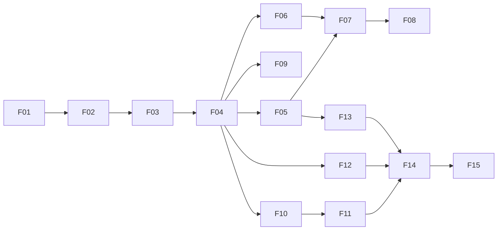

# STATUS — andamento do app mobile

Atualize este arquivo no fim de cada sessão de trabalho e ao abrir ou integrar um PR. A IA lê aqui qual é a etapa atual antes de começar.

**Etapa atual:** F13 (PR #55 aberto, depois do #54 da F12) → próxima: F14
**Branch:** `feature/F13-nfc-tags` (criada da `feature/F12-access-history`, porque as duas mexem no início e no "Em breve"; PR #55 sobre `develop`, depois do #54)
**Último teste vermelho/verde:** mensagens, estados vazio e de erro e tempo esgotado das tags (testes de cobertura), 1049 testes passando

**Resolvido (07/11):** a pilha F05 a F09 entrou em `develop` pelo PR #40, seguida da F10 (#41) e da F11 (#42).

Legenda: ⬜ pendente · 🟨 em andamento · ✅ pronta (critérios e DoD marcados, PR integrado em `develop`) · 🔴 essencial · 🟡 importante · 🟢 pode ser cortada · ❓ pergunta em aberto (lista no fim deste arquivo).

Arquivo de cada etapa: F01–F04 em `04-steps-F01-F04.md`, F09–F11 em `05-steps-F09-F11.md`, F05–F08 em `06-steps-F05-F08.md`, F12–F15 em `07-steps-F12-F15.md`.

## Etapas, ordem e prazos

Hoje é 28/10 e o app começa do zero. 💡 Por isso a ordem muda em relação ao plano antigo: **o fluxo da pessoa (login → início → leitor → resultado) vem antes dos cadastros do administrador**, porque é ele que a Review 2 cobra (M4). Na Review 2, os cadastros podem ser mostrados pelo Swagger (corte já previsto no plano do time). Confirme estas datas com o Eduardo na primeira reunião.

| ID | Etapa | Telas | Depende de (app) | Depende de (backend) | Prazo 💡 | Prioridade | Status | PR |
|---|---|---|---|---|---|---|---|---|
| F01 | Setup do app | — | — | B01 ✅ | 30/10 | 🔴 | 🟨 | [#14](https://github.com/prjDevflow/prj_4dsm/pull/14) |
| F02 | Tema e componentes base | Fundamentos, componentes, T31 | F01 | — | 01/11 | 🔴 | 🟨 | [#16](https://github.com/prjDevflow/prj_4dsm/pull/16) |
| F03 | Login | T02 | F02 | B05 ✅ | 03/11 | 🔴 | 🟨 | [#19](https://github.com/prjDevflow/prj_4dsm/pull/19) |
| F04 | Abertura, navegação por perfil, início e sessão | T01, T03, T13, T14 | F03 | B05 ✅ | 04/11 | 🔴 | 🟨 | PR #25 |
| F10 | Leitor de QR Code | T06, T07 | F04 | (B12 para QR real) | 05/11 | 🔴 | 🟨 | PR #41 |
| F11 | Validação do acesso e resultado | T08, T09, T10, T11 | F10 | B15 ✅ | 07/11 | 🔴 | 🟨 | PR #42 |
| F09 | Minhas autorizações | T04, T05 | F04 | B09 ✅ | 08/11 | 🔴 | 🟨 | PR #38 |
| — | Integração com backend e terminal, ensaio | — | F11, F09 | B15 | 09–10/11 | 🔴 | | |
| — | **Review 2 (M4: QR ponta a ponta)** | | | | **11/11 19h30** | | | |
| F05 | Usuários | T15, T16 | F04 | B06 ✅ | 13/11 | 🔴 | 🟨 | PR #28 |
| F06 | Locais e terminais | T17 a T22 | F04 | B07, B11 | 15/11 | 🔴 | 🟨 | PR #29 |
| F07 | Nova autorização | T24 | F05, F06 | B08 | 16/11 | 🔴 | 🟨 | PR #30 |
| F08 | Lista e cancelamento de autorizações | T23, T25 | F07 | B09 | 17/11 | 🔴 | 🟨 | PR #31 |
| F13 | Tags NFC | T28, T29, T30 | F05 | B16 ✅ | 18/11 | 🔴 | 🟨 | PR #55 |
| F12 | Histórico de acessos | T26, T27, T12 | F04 | B18 ✅ | 20/11 | 🟡 | 🟨 | PR #54 |
| F14 | Acessibilidade e usabilidade | todas | F11, F12, F13 | — | 22/11 | 🟡 | ⬜ | |
| F15 | Robustez, build e manual | T31, todas | F14 | B10 (URL de homologação) | 24/11 | 🟡 | ⬜ | |
| — | **Review 3** | | | | **25/11 19h30** | | | |

**Se apertar, pode cortar:** T05 (detalhe da autorização do usuário), T30 (vincular tag pelo terminal), T12 (meu histórico), a animação de mola do resultado (fica só a cor). **Nunca cortar:** F01 a F04, F10, F11, os testes e o CI.

---

---

## Marcos de integração (o que o app precisa mostrar)

| Marco | Quando | O que o app precisa | Com quem |
|---|---|---|---|
| M3 — O QR gira e é lido | antes da Review 2 | F10 lendo o QR do terminal (ou do simulador) | Matheus |
| **M4 — Acesso por QR ponta a ponta** | **Review 2, 11/11** | F03, F04, F09, F10, F11 (cadastros pelo Swagger) | Eduardo e Matheus |
| M2 — Cadastros completos pelo app | Sprint 3, semana 1 | F05, F06, F07, F08 | Eduardo e Matheus |
| M5 — Acesso por NFC | Sprint 3, semana 1 | F13 (tag vinculada pelo app) | Matheus |
| M6 — Resiliência e histórico | Sprint 3, semana 2 | F12 (tentativas offline aparecem com "Terminal sem conexão.") | Eduardo e Matheus |
| M7 — Ensaio final | antes da apresentação | tudo, no APK, na rede da apresentação | os quatro |

**Roteiro do M4 (Review 2)** — o app precisa acertar cada linha:

| # | Cenário | O app mostra |
|---|---|---|
| 1 | Visitante com autorização válida, perto do terminal, QR vigente | T10 "Acesso autorizado"; catraca abre |
| 2 | Ler de novo o mesmo QR já usado | T11 âmbar "Este QR Code já foi usado. Aguarde o próximo e leia de novo." |
| 3 | Admin cancela a autorização e o visitante tenta | T11 vermelha "Sua autorização foi cancelada. Procure a administração." |
| 4 | Celular a mais de 100 m (simulado ou com limite menor) | T11 âmbar "Você está longe da catraca. Aproxime-se e tente de novo." |
| 5 | Autorização fora do horário | T11 vermelha "Sua autorização não vale para esta data ou horário." |
| 6 | Autorização com 1 uso, já gasto | T11 vermelha "Você já usou todas as entradas desta autorização." |
| 7 | Esperar mais de 15 s com o QR lido e enviar (use o campo de colar em `__DEV__`) | T11 âmbar "Este QR Code expirou. Leia o novo QR Code que aparece na tela." |
| 8 | Conferir o histórico (Swagger ou F12) | uma tentativa por cenário, com o motivo |

**Plano B da demonstração:** se o terminal físico falhar, o QR do simulador ou o `npm run dev:qr` do backend na tela do computador; se a rede falhar, o vídeo gravado no ensaio.

---

---

## Decisões registradas (ADR curto)

Formato: data · decisão · motivo.

- 2026-10-28 · Arquitetura do frontend do estudos_dpi (Page → Model → View → Service) adaptada ao Expo Router, com as telas em `src/screens/` e as rotas finas em `src/app/` · pedido do Eduardo; no Expo Router todo arquivo de `src/app/` vira rota.
- 2026-10-28 · Expo Go, sem *development build* · o Pedro testa no próprio celular; só bibliotecas que já vêm no Expo Go.
- 2026-10-28 · Ordem: fluxo da pessoa (F01–F04, F10, F11, F09) antes dos cadastros (F05–F08) · app começa do zero em 28/10 e a Review 2 cobra o M4; cadastros pelo Swagger na Review 2 (💡 a confirmar com o Eduardo).
- 2026-10-28 · Serviços falsos por serviço (`EXPO_PUBLIC_FAKE_SERVICES`) · as rotas da B07 em diante ainda não existem.
- 2026-10-28 · Expo SDK 58 (não o 57 citado no README) · o Expo Go da loja só roda o SDK mais recente, que é o 58 desde 29/09.
- 2026-10-28 · Documentos do app em `mobile/.claude/` (e não em `mobile/docs/ai/`) · pedido do Pedro; o `mobile/CLAUDE.md` carrega o `AGENTS.md`. Os documentos ainda citam o caminho antigo `docs/ai/`.
- 2026-10-28 · MSW 3 no Jest com um ambiente próprio (`test/environment.js`) que devolve o `fetch` do Node · o Expo troca o `fetch` global por uma versão nativa que no Jest é um stub, e o MSW 3 só vem em ESM (o Babel transforma).
- 2026-10-28 · Componentes próprios em `components/ui` e `Icon` com os `MaterialIcons` do `@expo/vector-icons` (❓ 4, sugestão seguida) · como o shadcn no estudos_dpi; trocar a fonte dos ícones depois muda só o `Icon.tsx`.
- 2026-10-28 · `ThemeProvider` com a escala (`pessoa` ou `admin`) · os componentes escolhem a altura do botão e a tipografia pela escala; as telas do administrador envolvem o conteúdo em `<ThemeProvider scale="admin">`.
- 2026-10-28 · `StatusBadge` segue o Figma: pílula com texto e cor, e cookie com check ou X só em Autorizado e Negado · o plano pedia ícone em todos os selos, mas o Figma (T31) não tem, e o Figma manda no visual.
- 2026-10-28 · Visual conferido pelo PDF do Figma (`docs/app-mobile/design/passe-telas.pdf`) · a conta do Pedro não tem acesso de edição ao arquivo do Figma, e sem isso a integração não lê as telas.
- 2026-10-28 · Com a fonte do sistema a partir de 130%, o selo do `ListItem` desce para baixo do título · no emulador a 200% o título e o e-mail ficavam espremidos ao lado do selo.
- 2026-11-01 · Na F04, os blocos do administrador e os atalhos da pessoa abrem telas "Em breve" (`/admin/[area]` e `/em-breve/[area]`) · as telas de verdade chegam da F05 em diante; assim a navegação já fica pronta e testada.
- 2026-11-01 · Ficam de fora da F04 o cartão "Você pode entrar agora" (❓ 3), o alerta de terminal offline (❓ 13), a opção de tema (❓ 2) e o contador de autorizações (F09) · são Ideias do design à espera do aval do grupo, ou dependem de outra etapa.
- 2026-11-01 · A T14 ganhou "Sair" no rodapé, como a T03 · o card da F04 pede "Sair" no início do administrador; no Figma ele fica só em Minha conta.
- 2026-11-03 · Na F07, depois de criar, o app volta para a tela de onde veio (hoje, "Autorizações" com "Em breve") em vez da lista · a lista é a F08; a criação já invalida `['authorizations']`, então a F08 mostra a nova no topo quando chegar.
- 2026-11-03 · Na F07, o resumo diz "poderá entrar em Catraca Social (Edifício Central)" em vez de "na Catraca Social do Edifício Central" · o app não sabe se o nome do local pede "na" ou "no"; o texto do card fica igual em todo o resto.
- 2026-11-03 · Na F07, o resumo só aparece quando o formulário passaria na validação, e é montado do mesmo objeto enviado à API · assim ele nunca mostra algo que o servidor recusaria.
- 2026-11-13 · Na T28, o código da tag aparece parcial ("••••C3D4") e, no detalhe, inteiro · o card pede "UID (parcial)"; o Figma mostra inteiro. O leitor de tela diz "Tag terminada em C3D4".
- 2026-11-13 · A T28 busca só por pessoa · a API filtra só por `usuarioId`; o "Buscar por código ou pessoa" do Figma ficaria pela metade.
- 2026-11-13 · O detalhe da tag lê a lista já carregada · não há `GET /nfc-tags/:id`; o nome vem de `/users`, porque a lista traz só `usuarioId`.
- 2026-11-13 · T30 (❓ 19): o app liga o modo de cadastro e consulta `GET /nfc-tags?usuarioId=` a cada 2 s, por 60 s contados no aparelho · a tag nova é a que não estava na lista antes de ligar. "Cancelar" só sai da tela: não há rota para desligar o modo, que expira sozinho.
- 2026-11-13 · "Ler tag no terminal" pede a pessoa antes e troca o formulário pela leitura · a tag lida já sai vinculada, então o formulário não tem mais o que salvar.
- 2026-11-12 · O histórico mostra o motivo em texto curto, como no Figma ("QR Code expirado"), num mapa próprio (`lib/accessEvents.ts`) com os 13 códigos · as frases da tela de resultado continuam no `denialReasons`; código desconhecido vira "Motivo não informado".
- 2026-11-12 · O item da T26 traz `dd/MM HH:mm:ss`, sem os cabeçalhos "Hoje" e "Ontem" do Figma · o card pede a data e a hora no item; agrupar por dia com paginação fica para depois.
- 2026-11-12 · A T27 lê a tentativa da lista já carregada · a API não tem rota de um evento, e os eventos nunca mudam. Aberta por link, sem a lista, mostra "Tentativa não encontrada."
- 2026-11-12 · O período padrão são hoje e os 6 dias anteriores, de 00:00 ao último milissegundo, em `-03:00` · São Paulo não tem horário de verão desde 2019.
- 2026-11-12 · A T12 não tem filtros nem período · o card a descreve como "tela simples".
- 2026-11-07 · O leitor já começa a pegar a posição e a validação usa a pronta, uma vez só · o QR vale 15 s e o GPS pode levar 8 s; a posição preparada vale 30 s, e "Tentar de novo" lê outra vez, para ver onde a pessoa está agora.
- 2026-11-07 · A pergunta da localização (T08) fica na validação, como no card, e o leitor só prepara a posição se a permissão já existe · na primeira vez, o QR pode expirar durante a pergunta, e o "Ler outro QR Code" resolve.
- 2026-11-07 · Sem conexão e erro do servidor usam o título "Acesso não validado", em âmbar · ninguém negou nada, e o card e o `tokens.md` não definem esse título. 429 e 422 inesperado caem no "Não foi possível validar agora".
- 2026-11-07 · A T11 não mostra local nem hora, que o Figma desenha · o 403 da API traz só `code` e `message`, e o card não pede.
- 2026-11-07 · A T09 mostra "Localização confirmada" só quando há uma posição · sem GPS, a frase seria falsa.
- 2026-11-07 · Código desconhecido num 403 vira erro do servidor, sem registro · o app não tem logger, e `no-console` é erro no lint.
- 2026-11-07 · "Simular posição" em `__DEV__` · a catraca do seed fica longe de quem testa em casa.
- 2026-11-07 · Na volta das configurações, o leitor pede a câmera de novo em vez de só consultar · no Android, o Expo Go guarda por projeto quem negou e ignora o sistema até o app perguntar; quem negava ficava preso, mesmo reiniciando. Só pergunta se a pessoa saiu pelo botão "Abrir configurações", porque fechar a pergunta do sistema também devolve o app à frente e isso viraria um laço.
- 2026-11-07 · O selo "Localização pronta" da T07 e o pedido antecipado de localização ficam para a F11 · dependem da T08; no card são só uma sugestão para ganhar tempo.
- 2026-11-07 · Até a F11 existir, um QR válido vai para a tela "Em breve" da validação, com `replace` · o "voltar" não pode retornar a uma câmera que já parou de ler.
- 2026-11-07 · O campo de colar aparece em `__DEV__` também com a câmera aberta · sem ele, testar exigiria um QR físico a cada vez. Em produção não existe.
- 2026-11-05 · Na F09, os selos da T04 têm ícone (`withIcon`), e as telas do administrador seguem só com texto e cor · o card pede texto, ícone e cor; o Figma e o `tokens.md` mostram só texto, e o ícone espremeria as listas do administrador.
- 2026-11-05 · Na F09, as anteriores contam as entradas usadas ("Usadas 0 de 2"), sem barra · "Restam 2 de 2" com a barra cheia numa expirada parecia válida. O Figma não desenha esse estado.
- 2026-11-05 · Na F09, o aviso "Agora está fora do horário permitido." também vale antes do primeiro dia do período · a API nega nesse caso (`FORA_DO_PERIODO`), e a pessoa não pode achar que entra.
- 2026-11-05 · Na T04, a validade segue o card e o Figma ("Válida de 20/10 a 25/10"), com o ano só quando o período cruza o ano · o critério fala em `dd/MM/aaaa`, mas o elemento do card e o Figma mostram a forma curta.
- 2026-11-05 · T05 (detalhe, 🟢 extra) ficou de fora da F09 · o card não pede e o cartão da T04 já mostra tudo; a Review 2 cobra F10 e F11.
- 2026-11-05 · `formatDateTime` e o aviso da T04 usam a hora de São Paulo com `Intl` e `format()`, não `formatToParts()` · o resultado não pode depender do fuso do aparelho, e `formatToParts` não é confiável no Hermes do iOS.
- 2026-11-03 · Na F08, o filtro "Pessoa" abre a lista de pessoas com busca, em vez de texto livre, e inclui inativas · a API filtra por `usuarioId`, não por nome, e autorizações antigas podem ser de quem já foi desativado.
- 2026-11-03 · Na F08, a lista mostra o ano só quando o período cruza o ano · sem isso, "28/10/2026 a 28/10/2027" aparecia como "28/10 a 28/10".
- 2026-11-03 · Na F08, depois de cancelar, o app grava a resposta no cache do detalhe e das listas e ainda invalida as listas · o selo muda na hora, e a pessoa sai de filtros como "Ativas" ao recarregar. Erros do cancelamento ficam no diálogo.
- 2026-11-03 · O `Dialog` rola só o texto e deixa os botões fixos · a F08 pôs nele o primeiro campo, que cresce até 200 caracteres; com fonte 200% e teclado, os botões iam para trás do teclado.
- 2026-11-03 · Na F07, o app também recusa data final no passado ("A data final não pode estar no passado.") · é regra do servidor (B08); avisar antes evita o 422.
- 2026-11-03 · Com a fonte do sistema a partir de 130%, campos lado a lado (datas, horários, coordenadas) vão um por linha (`FieldRow`) e os botões do rodapé se empilham · em 200% a data quebrava ao meio e os botões se sobrepunham.
- 2026-11-02 · Na F06, a chave do terminal só vive no estado da tela T22: o cadastro e o "Gerar nova chave" chamam o serviço direto, sem `useMutation` · o cache de mutações do TanStack Query guardaria a resposta, e a resposta traz a chave.
- 2026-11-02 · Na F06, a T22 só sai por "Concluir": o voltar do Android não faz nada e o gesto do iPhone fica desligado · a chave não é mostrada de novo; sair sem querer obrigaria a gerar outra.
- 2026-11-02 · Na F06, as telas carregam todas as páginas de edifícios, pontos e terminais de uma vez (100 por página) · um condomínio tem poucos locais, e não há `GET` de um edifício ou ponto só: a edição usa a lista.
- 2026-11-02 · Na F06, coordenada vazia mostra "Informe a latitude." (ou longitude), e fora da faixa ou não numérica, "Latitude inválida." · o card só define a mensagem de inválida.
- 2026-11-02 · Na F06, "Terminais" conta como offline só os terminais ativos sem contato · um terminal desativado não deve aparecer como problema.
- 2026-11-02 · Na F06, a lista e o detalhe dos terminais buscam de novo a cada 15 s e o "Visto há" relê o relógio no mesmo ritmo · o servidor considera online quem falou nos últimos 30 s.
- 2026-11-02 · Na F05, o Perfil do cadastro é um grupo de opções à vista (`RadioGroup`), e não o `SelectField` · o Figma (T16) mostra as três opções na tela.
- 2026-11-02 · Na F05, `EXPO_PUBLIC_FAKE_SERVICES=users` troca juntos os quatro serviços de `/users` · os falsos dividem uma lista em memória; trocar só um deixaria o cadastrado fora da lista.
- 2026-11-02 · Na F05, "Mostrar usuários inativos" desligado envia `ativo=true`; ligado não envia `ativo` · ligado mostra todos, ativos e inativos, com o selo "Inativo".
- 2026-11-02 · Na F05, a mensagem do 409 `AUTO_DESATIVACAO` depende do que foi enviado ("desativar a si mesmo", "alterar o próprio perfil" ou os dois) · a API usa um só código para os dois casos.
- 2026-11-02 · Na F05, a faixa de erro do formulário fica no rodapé, acima de "Cancelar" e "Salvar" · no emulador ela ficava escondida no fim do formulário.
- 2026-10-29 · Na F03, o login leva a inícios provisórios (Administração ou Início, com saudação, perfil e "Sair") · o card pede o início de cada perfil, mas a T03, a T14 e a sessão que sobrevive ao fechamento são da F04.
- 2026-10-29 · A tela "API: ok" vira `/health`, ferramenta só de desenvolvimento aberta pelo rodapé do login · com o login, o app abre em `/login`, e `/` passou a ser o início do perfil.
- 2026-10-29 · O topo do login segue o Figma (logo, "Controle de Acesso" pequeno e "Entre com sua conta" como título) e o botão tem 60 · o card pedia "Controle de Acesso" como título e botão de 56; o Figma e o `tokens.md` mandam no visual.
- 2026-10-28 · `npm run mock` com um proxy (`scripts/mock.mjs`) na frente do Prism · o Prism ignora o `/api/v1` de `servers`; assim o mock e a API real usam a mesma URL, mudando só a porta.

## Registro de sessões

| Data | Etapa | O que foi feito | Próximo passo |
|---|---|---|---|
| 2026-10-28 | — | Documentos do app criados (00 a 08, STATUS, AGENTS) | F01 |
| 2026-10-28 | F01 | App Expo SDK 58 com Expo Router; env, ApiError, AxiosInstance, SessionStore, tokenStorage, container, GetHealthService e tela provisória "API: ok"/"API: fora do ar" (32 testes); mock do openapi; jobs `mobile` e `mobile-ci` no CI; README do app. Conferido no emulador Android com o mock | Testar no celular com o backend do Docker e anexar o print ao PR; aval do Eduardo no CI; F02 |
| 2026-10-28 | F02 | Tema do `tokens.md` (cores conferidas pelo teste contra o próprio `tokens.md`, contraste WCAG), fonte Atkinson com a splash, formas, `Icon` e 25 componentes em `components/ui`; catálogo em `/catalog` só em `__DEV__`; teste que percorre o catálogo e exige papel e rótulo em todo elemento interativo. Conferido no emulador a 100% e a 200% (161 testes) | Testar o catálogo no celular; revisão do Rafael e do Eduardo; F03 |
| 2026-10-28 | F01, F02 | Revisão: no celular do Pedro (Expo Go), "API: ok" com o mock e "API: fora do ar" sem ele, sem fechar o app. Corrigidos na F02: anúncio do erro de campo, dos avisos e dos estados no iOS (`useAnnounce`), aviso curto lido uma vez, rodapé em linha com fragmento, "Voltar" do catálogo aberto por link; o teste de contraste cobre as partes que não são texto (175 testes) | F01: celular com o Docker e revisor no #14; F02: catálogo no celular e revisão do Eduardo |
| 2026-10-29 | F03 | Login (T02): schema, mensagens, `LoginUserService` e falso com os usuários do seed, model com toque duplo, senha limpa e foco, faixa que some ao digitar e aviso de sessão expirada; guards por sessão (`Stack.Protected` com `redirectTo`) e inícios provisórios; `/health` vira ferramenta de desenvolvimento. Emulador contra a API real no Docker: os três perfis, senha errada, sem internet, voltar do Android, fonte em 200% com teclado. Corrigido no aparelho: o foco não ia para a senha depois do erro | Abrir o PR (base #16); GIF; ouvir com TalkBack/VoiceOver; Eduardo confirmar o contrato; teste com uma pessoa; F04 |
| 2026-11-13 | F13 | Tags NFC: T28 com código parcial, pessoa, descrição e selo, busca por pessoa; T29 com o UID normalizado e o erro de tag repetida no campo; detalhe com "Tag ativa" e confirmação; T30 com contagem de 60 s. Emulador contra a API real, com o terminal pela rota dele (`POST /terminal/nfc`): `0a:0b:0c:0d` salvo como `0A0B0C0D` e aceito pelo terminal; repetida recusada no campo; desativada, o terminal negou na hora com `TAG_INATIVA`; no modo de cadastro, a leitura voltou `CADASTRADA` e o app mostrou "Tag vinculada a Condômino de Teste."; o tempo esgotado também apareceu. Com o ESP32 do Pedro: "Ler tag no terminal" vinculou o chaveiro azul (`4E7BBB06`) ao visitante, e as leituras seguintes abriram a catraca. Achados: `terminal/docs/tags-demo.md` troca os UIDs do chaveiro e do cartão; o RC522 parou de ler até reiniciar a placa; no modo de cadastro, uma tag já cadastrada recebe 409 só no terminal e o app espera os 60 s. 1049 testes, 96,7% de linhas | Revisão dos PRs #54 e #55; F14 |
| 2026-11-12 | F12 | Histórico: T26 com os filtros em chips (período nos últimos 7 dias, resultado, pessoa, local, método, motivo) e "Limpar filtros", T27 com todos os campos, distância e "Ver autorização", T12 Meu histórico. Emulador contra a API real de `develop`, com as tentativas do ESP32 e do iPhone de 10/11: uma leitura NFC no terminal apareceu em 3,4 s depois de puxar a lista; "Negado" deixou só as negações; 100% e 200%. 966 testes, 96,8% de linhas | Revisão do PR #54; F13 |
| 2026-11-07 | F11 | Validação e resultado: permissão de localização (T08), progresso (T09), autorizado (T10), negado âmbar e vermelho (T11), selo "Localização pronta" no leitor, posição preparada, "Simular posição". Emulador contra a API real da `develop`: os 10 motivos, cenários 1 a 7 do M4, sinal `ABRIR`/`NEGAR` igual ao resultado, 1 evento por tentativa, 1,1 a 1,4 s do toque ao resultado, 100% e 200%. No iPhone do Pedro, com um terminal virtual no computador e a câmera lendo o QR que muda: negação por distância e autorização, com "Catraca aberta" no terminal. 888 testes, 96,8% de linhas | Aceitar #40, #41 e #42; ensaio com o Eduardo e o Matheus; medir os 3 s em celular real; F13 e F12 |
| 2026-11-07 | F10 | Leitor de QR Code: permissão da câmera (T06) com pedido, recusa e configurações, leitor (T07) com moldura, lanterna, dica e aviso de QR de outro tipo, leitura congelada e vibração. Conferido no emulador com leitura real pela câmera (`-camera-back imagefile:`), em 100% e 200%, e no iPhone do Pedro, que leu um QR fixo e abriu a validação. 704 testes, 96,5% de linhas. PRs #40 (F05 a F09 para `develop`) e #41 (F10) | Aceitar o #40 e depois o #41; testar no segundo celular real, medir os 2 s e a distância de 20 a 40 cm, com vídeo no PR; depois, F11 |
| 2026-11-05 | F09 | Minhas autorizações (T04): ativas, anteriores recolhidas, aviso de fora do horário em São Paulo, selos com texto, ícone e cor, vazio, erro e puxar para atualizar; contador no início. Conferido no emulador contra a API real, em 100% e 200%, com o aparelho em UTC. 648 testes, 96,4% de linhas | Revisão do PR #38; teste de 10 s com quem não conhece o sistema; "Abrir catraca" leva ao "Em breve" até a F10; depois, F10 |
| 2026-11-03 | F08 | Lista de autorizações (T23) com filtros sozinhos e combinados, paginação e puxar para atualizar; detalhe (T25) com auditoria; cancelamento confirmado com motivo opcional, que muda o selo na lista e no detalhe sem reabrir. Conferido no emulador contra a API real, em 100% e 200%, inclusive dois administradores cancelando a mesma. 591 testes, 96,3% de linhas | Revisão do PR #31; a negação no acesso depois de cancelar depende da B15 e da F11; depois, F10 |
| 2026-11-03 | F07 | Nova autorização (T24): pessoa com busca (só ativas, nome e perfil), local agrupado por edifício (só ativos), datas com padrão hoje, horários 08:00 e 18:00, utilizações de 1 a 1000, atalhos "Só hoje" e "Próximos 7 dias", resumo que acompanha o que será enviado, "Criando…", 404 e 422 nos lugares do card, descartar; "Autorizações" oferece "Nova autorização" até a F08. Emulador contra a API real: pessoas e locais ativos, horário final antes do inicial recusado, criada e conferida pela API com os mesmos valores e "Ativa", fonte em 200%. Corrigido no aparelho: datas quebrando e botões do rodapé sobrepostos com fonte grande | Abrir o PR (base #29); conferir no Swagger do Eduardo; F08 |
| 2026-11-02 | F06 | Locais e terminais (T17), edifício (T18) e ponto de acesso (T19) com "Usar minha localização atual" e coordenadas com vírgula; terminais (T20) com Online/Offline e "Visto há"; novo terminal e detalhe (T21) com "Gerar nova chave" confirmada; chave mostrada uma vez (T22), fora do cache, com "Copiar chave". Peças de formulário compartilhadas (rodapé, descartar, voltar do Android) também no formulário de usuários. Emulador contra a API real: edifício → ponto → terminal, permissão de localização negada e concedida, latitude 91 recusada, chave copiada (conferida colando), heartbeat simulado com a chave da tela (Online e depois Offline), chave antiga recusada (401) depois de gerar outra, "Catraca de Testes" com autorização ativa recusada, fonte em 200% | Abrir o PR (base #28); GIF; o Matheus cadastrar o terminal dele pelo app; F10 |
| 2026-11-02 | F05 | Lista de usuários (T15): busca 400 ms depois de parar de digitar, filtro de perfil, inativos, rolagem infinita, puxar para atualizar e estados; cadastro e edição (T16) com `RadioGroup` de perfil, 409 no campo E-mail, `AUTO_DESATIVACAO` e `ULTIMO_ADMIN` na faixa, 422 nos campos, PATCH só com o que mudou e "Descartar alterações?" (também no voltar do Android). Serviços de `/users` e falsos com as regras do B06. Emulador contra a API real (seed mais 22 pessoas de teste): paginação, busca com filtro, e-mail repetido, cadastrar, desativar a si mesmo e outra pessoa, inativos, fonte em 200%. Corrigidos no aparelho: faixa de erro escondida, teclado sobre o formulário, selos espremendo o e-mail | Abrir o PR (base #25); GIF; F10 |
| 2026-11-01 | F04 | Abertura (T01) que restaura a sessão com `GET /auth/me`; início da pessoa (T03) e do administrador (T14) com o Figma; Minha conta (T13); "Sair" com diálogo de confirmação que limpa token e cache; `/admin` só para ADMIN; telas "Em breve"; faixa "Sem internet" (netinfo). Emulador contra a API real: reabrir já logado, Sair e voltar, admin → visitante, modo avião no início e na abertura | Abrir o PR (base #19); GIF de abrir já logado, sair e entrar com outro perfil; F10 |

---

## Checklist final (Pedro)

- [ ] F01 a F15 concluídas (ou cortes combinados com o Eduardo e registrados no STATUS).
- [ ] Textos de negação iguais ao contrato, palavra por palavra.
- [ ] CI do app verde, com testes de login, leitor, validação e formulários.
- [ ] Relatório de usabilidade, manual do usuário e APK prontos.
- [ ] Seção "App móvel" da documentação técnica entregue.

---

---

## Perguntas em aberto ❓

Nada aqui bloqueia o começo. Cada item tem uma sugestão para seguir enquanto a resposta não vem.

| # | Pergunta | Quem decide | Enquanto isso 💡 |
|---|---|---|---|
| 1 | O nome "Passe" e a identidade valem para o app? | Grupo | Usar "Passe" (provisório) no `app.json` |
| 2 | Tema escuro como padrão e claro como opção em "Minha conta" (configuração só local)? | Grupo e teste ao sol | Só o tema escuro; o claro depois, com o esquema claro do Material 3 |
| 3 | Entra o bloco "Você pode entrar agora" na T03? | Grupo | Não implementar até o aval |
| 4 | Ícones: os Material Symbols do Figma não vêm no `@expo/vector-icons` (que tem os Material Icons antigos). E os componentes: próprios ou `react-native-paper` (sugestão do design)? | Pedro e Eduardo | Componentes próprios em `components/ui` (como o shadcn no estudos_dpi) e um `Icon` que usa os `MaterialIcons` do `@expo/vector-icons` por enquanto; trocar depois sem mexer nas telas |
| 5 | As rotas da B07 em diante ainda não estão no `openapi.yaml`. O Eduardo pode publicar os schemas (B07, B08, B09, B15) antes do código, para os falsos do app baterem com o real? | Eduardo | Usar os exemplos dos guias `05`, `06` e `07` do backend |
| 6 | Se o GPS não responder em 8 s, o app envia a validação sem coordenadas (o servidor devolve `LOCALIZACAO_INVALIDA` e registra a tentativa) ou não envia? | Eduardo | Feito assim na F11: envia sem coordenadas, e o evento fica registrado |
| 7 | `GET /me/authorizations` é paginada? | Eduardo | Respondida em 05/11: é paginada, até 100 por página (B09). O app busca todas as páginas |
| 8 | Texto para `ULTIMO_ADMIN` (e outros textos novos que não estão nos requisitos) | Eduardo | "O sistema precisa de pelo menos um administrador ativo." |
| 9 | Coordenadas digitadas com vírgula decimal (T18, T19) | Eduardo e Pedro | Aceitar vírgula e ponto, enviar número |
| 10 | Formato de exibição da chave do terminal na T22 (inteira, em blocos?) | Eduardo | Inteira, em fonte monoespaçada, com "Copiar chave" |
| 11 | Regra de cor da negação (âmbar quando a pessoa resolve, vermelho quando depende da administração), e o terminal usa a mesma? | Grupo e Matheus | Seguir o `tokens.md` |
| 12 | A animação de mola cabe na meta de 3 s? | Pedro (medindo) | Respondida em 07/11: cabe. No emulador, de 1,1 a 1,4 s do toque à tela do resultado; falta medir em celular real |
| 13 | Alerta de terminal offline na T14 e na T17 | Grupo | Fora até o aval |
| 14 | Como o visitante recebe a senha (hoje o administrador define na T16)? | Grupo e Eduardo | O administrador informa pessoalmente |
| 15 | O raio de 100 m é máximo ou mínimo? | Professor | Máximo (decisão 1 do contrato) |
| 16 | Quem mantém o simulador do terminal (I02), para o app ler um QR real antes do ESP32 ficar pronto? | Eduardo e Matheus | QR fixo gerado no computador (F10) e, depois da B12, o `npm run dev:qr` |
| 17 | O check `mobile-ci` entra como obrigatório no ruleset de `develop` e `main`? | Eduardo | Rodar no PR; o Eduardo decide |
| 18 | A escala compacta do administrador (corpo 16, abaixo dos 18 da tabela de requisitos) está aprovada? | Grupo | Seguir o Figma |
| 19 | Na T30, como o app sabe que a tag foi vinculada pelo terminal? Consultar `GET /nfc-tags?usuarioId=` a cada 2 s durante os 60 s? | Eduardo | Consultar a lista a cada 2 s; a T30 é extra e pode ser cortada |
