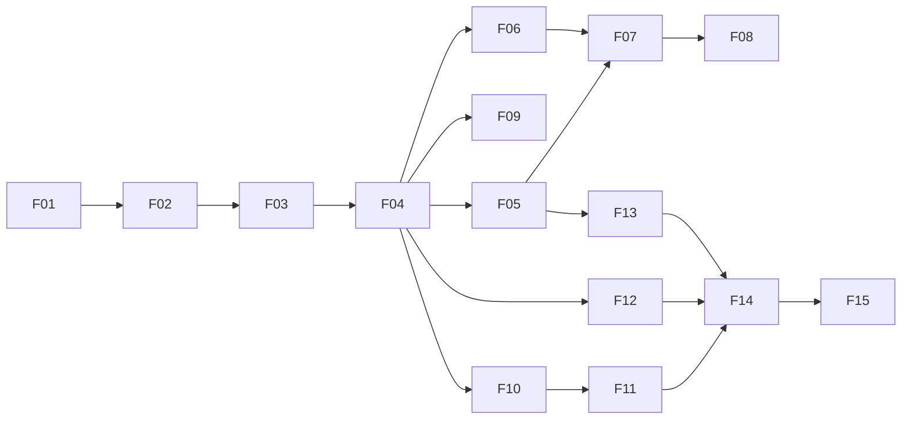

# STATUS — andamento do app mobile

Atualize este arquivo no fim de cada sessão de trabalho e ao abrir ou integrar um PR. A IA lê aqui qual é a etapa atual antes de começar.

**Etapa atual:** F01 (PR aberto para `develop`, em revisão) → próxima: F02
**Branch:** `F01-Setup-do-app`
**Último teste vermelho/verde:** `HealthView` (green), 32 testes passando

Legenda: ⬜ pendente · 🟨 em andamento · ✅ pronta (critérios e DoD marcados, PR integrado em `develop`) · 🔴 essencial · 🟡 importante · 🟢 pode ser cortada · ❓ pergunta em aberto (lista no fim deste arquivo).

Arquivo de cada etapa: F01–F04 em `04-steps-F01-F04.md`, F09–F11 em `05-steps-F09-F11.md`, F05–F08 em `06-steps-F05-F08.md`, F12–F15 em `07-steps-F12-F15.md`.

## Etapas, ordem e prazos

Hoje é 28/10 e o app começa do zero. 💡 Por isso a ordem muda em relação ao plano antigo: **o fluxo da pessoa (login → início → leitor → resultado) vem antes dos cadastros do administrador**, porque é ele que a Review 2 cobra (M4). Na Review 2, os cadastros podem ser mostrados pelo Swagger (corte já previsto no plano do time). Confirme estas datas com o Eduardo na primeira reunião.

| ID | Etapa | Telas | Depende de (app) | Depende de (backend) | Prazo 💡 | Prioridade | Status | PR |
|---|---|---|---|---|---|---|---|---|
| F01 | Setup do app | — | — | B01 ✅ | 30/10 | 🔴 | 🟨 | a abrir |
| F02 | Tema e componentes base | Fundamentos, componentes, T31 | F01 | — | 01/11 | 🔴 | ⬜ | |
| F03 | Login | T02 | F02 | B05 ✅ | 03/11 | 🔴 | ⬜ | |
| F04 | Abertura, navegação por perfil, início e sessão | T01, T03, T13, T14 | F03 | B05 ✅ | 04/11 | 🔴 | ⬜ | |
| F10 | Leitor de QR Code | T06, T07 | F04 | (B12 para QR real) | 05/11 | 🔴 | ⬜ | |
| F11 | Validação do acesso e resultado | T08, T09, T10, T11 | F10 | B15 (falso até sair) | 07/11 | 🔴 | ⬜ | |
| F09 | Minhas autorizações | T04, T05 | F04 | B09 (falso até sair) | 08/11 | 🔴 | ⬜ | |
| — | Integração com backend e terminal, ensaio | — | F11, F09 | B15 | 09–10/11 | 🔴 | | |
| — | **Review 2 (M4: QR ponta a ponta)** | | | | **11/11 19h30** | | | |
| F05 | Usuários | T15, T16 | F04 | B06 ✅ | 13/11 | 🔴 | ⬜ | |
| F06 | Locais e terminais | T17 a T22 | F04 | B07, B11 | 15/11 | 🔴 | ⬜ | |
| F07 | Nova autorização | T24 | F05, F06 | B08 | 16/11 | 🔴 | ⬜ | |
| F08 | Lista e cancelamento de autorizações | T23, T25 | F07 | B09 | 17/11 | 🔴 | ⬜ | |
| F13 | Tags NFC | T28, T29, T30 | F05 | B16 | 18/11 | 🔴 | ⬜ | |
| F12 | Histórico de acessos | T26, T27, T12 | F04 | B18 | 20/11 | 🟡 | ⬜ | |
| F14 | Acessibilidade e usabilidade | todas | F11, F12, F13 | — | 22/11 | 🟡 | ⬜ | |
| F15 | Robustez, build e manual | T31, todas | F14 | B10 (URL de homologação) | 24/11 | 🟡 | ⬜ | |
| — | **Review 3** | | | | **25/11 19h30** | | | |

**Se apertar, pode cortar:** T05 (detalhe da autorização do usuário), T30 (vincular tag pelo terminal), T12 (meu histórico), a animação de mola do resultado (fica só a cor). **Nunca cortar:** F01 a F04, F10, F11, os testes e o CI.

---

---

## Marcos de integração (o que o app precisa mostrar)

| Marco | Quando | O que o app precisa | Com quem |
|---|---|---|---|
| M3 — O QR gira e é lido | antes da Review 2 | F10 lendo o QR do terminal (ou do simulador) | Matheus |
| **M4 — Acesso por QR ponta a ponta** | **Review 2, 11/11** | F03, F04, F09, F10, F11 (cadastros pelo Swagger) | Eduardo e Matheus |
| M2 — Cadastros completos pelo app | Sprint 3, semana 1 | F05, F06, F07, F08 | Eduardo e Matheus |
| M5 — Acesso por NFC | Sprint 3, semana 1 | F13 (tag vinculada pelo app) | Matheus |
| M6 — Resiliência e histórico | Sprint 3, semana 2 | F12 (tentativas offline aparecem com "Terminal sem conexão.") | Eduardo e Matheus |
| M7 — Ensaio final | antes da apresentação | tudo, no APK, na rede da apresentação | os quatro |

**Roteiro do M4 (Review 2)** — o app precisa acertar cada linha:

| # | Cenário | O app mostra |
|---|---|---|
| 1 | Visitante com autorização válida, perto do terminal, QR vigente | T10 "Acesso autorizado"; catraca abre |
| 2 | Ler de novo o mesmo QR já usado | T11 âmbar "Este QR Code já foi usado. Aguarde o próximo e leia de novo." |
| 3 | Admin cancela a autorização e o visitante tenta | T11 vermelha "Sua autorização foi cancelada. Procure a administração." |
| 4 | Celular a mais de 100 m (simulado ou com limite menor) | T11 âmbar "Você está longe da catraca. Aproxime-se e tente de novo." |
| 5 | Autorização fora do horário | T11 vermelha "Sua autorização não vale para esta data ou horário." |
| 6 | Autorização com 1 uso, já gasto | T11 vermelha "Você já usou todas as entradas desta autorização." |
| 7 | Esperar mais de 15 s com o QR lido e enviar (use o campo de colar em `__DEV__`) | T11 âmbar "Este QR Code expirou. Leia o novo QR Code que aparece na tela." |
| 8 | Conferir o histórico (Swagger ou F12) | uma tentativa por cenário, com o motivo |

**Plano B da demonstração:** se o terminal físico falhar, o QR do simulador ou o `npm run dev:qr` do backend na tela do computador; se a rede falhar, o vídeo gravado no ensaio.

---

---

## Decisões registradas (ADR curto)

Formato: data · decisão · motivo.

- 2026-10-28 · Arquitetura do frontend do estudos_dpi (Page → Model → View → Service) adaptada ao Expo Router, com as telas em `src/screens/` e as rotas finas em `src/app/` · pedido do Eduardo; no Expo Router todo arquivo de `src/app/` vira rota.
- 2026-10-28 · Expo Go, sem *development build* · o Pedro testa no próprio celular; só bibliotecas que já vêm no Expo Go.
- 2026-10-28 · Ordem: fluxo da pessoa (F01–F04, F10, F11, F09) antes dos cadastros (F05–F08) · app começa do zero em 28/10 e a Review 2 cobra o M4; cadastros pelo Swagger na Review 2 (💡 a confirmar com o Eduardo).
- 2026-10-28 · Serviços falsos por serviço (`EXPO_PUBLIC_FAKE_SERVICES`) · as rotas da B07 em diante ainda não existem.
- 2026-10-28 · Expo SDK 58 (não o 57 citado no README) · o Expo Go da loja só roda o SDK mais recente, que é o 58 desde 29/09.
- 2026-10-28 · Documentos do app em `mobile/.claude/` (e não em `mobile/docs/ai/`) · pedido do Pedro; o `mobile/CLAUDE.md` carrega o `AGENTS.md`. Os documentos ainda citam o caminho antigo `docs/ai/`.
- 2026-10-28 · MSW 3 no Jest com um ambiente próprio (`test/environment.js`) que devolve o `fetch` do Node · o Expo troca o `fetch` global por uma versão nativa que no Jest é um stub, e o MSW 3 só vem em ESM (o Babel transforma).
- 2026-10-28 · `npm run mock` com um proxy (`scripts/mock.mjs`) na frente do Prism · o Prism ignora o `/api/v1` de `servers`; assim o mock e a API real usam a mesma URL, mudando só a porta.

## Registro de sessões

| Data | Etapa | O que foi feito | Próximo passo |
|---|---|---|---|
| 2026-10-28 | — | Documentos do app criados (00 a 08, STATUS, AGENTS) | F01 |
| 2026-10-28 | F01 | App Expo SDK 58 com Expo Router; env, ApiError, AxiosInstance, SessionStore, tokenStorage, container, GetHealthService e tela provisória "API: ok"/"API: fora do ar" (32 testes); mock do openapi; jobs `mobile` e `mobile-ci` no CI; README do app. Conferido no emulador Android com o mock | Testar no celular com o backend do Docker e anexar o print ao PR; aval do Eduardo no CI; F02 |

---

## Checklist final (Pedro)

- [ ] F01 a F15 concluídas (ou cortes combinados com o Eduardo e registrados no STATUS).
- [ ] Textos de negação iguais ao contrato, palavra por palavra.
- [ ] CI do app verde, com testes de login, leitor, validação e formulários.
- [ ] Relatório de usabilidade, manual do usuário e APK prontos.
- [ ] Seção "App móvel" da documentação técnica entregue.

---

---

## Perguntas em aberto ❓

Nada aqui bloqueia o começo. Cada item tem uma sugestão para seguir enquanto a resposta não vem.

| # | Pergunta | Quem decide | Enquanto isso 💡 |
|---|---|---|---|
| 1 | O nome "Passe" e a identidade valem para o app? | Grupo | Usar "Passe" (provisório) no `app.json` |
| 2 | Tema escuro como padrão e claro como opção em "Minha conta" (configuração só local)? | Grupo e teste ao sol | Só o tema escuro; o claro depois, com o esquema claro do Material 3 |
| 3 | Entra o bloco "Você pode entrar agora" na T03? | Grupo | Não implementar até o aval |
| 4 | Ícones: os Material Symbols do Figma não vêm no `@expo/vector-icons` (que tem os Material Icons antigos). E os componentes: próprios ou `react-native-paper` (sugestão do design)? | Pedro e Eduardo | Componentes próprios em `components/ui` (como o shadcn no estudos_dpi) e um `Icon` que usa os `MaterialIcons` do `@expo/vector-icons` por enquanto; trocar depois sem mexer nas telas |
| 5 | As rotas da B07 em diante ainda não estão no `openapi.yaml`. O Eduardo pode publicar os schemas (B07, B08, B09, B15) antes do código, para os falsos do app baterem com o real? | Eduardo | Usar os exemplos dos guias `05`, `06` e `07` do backend |
| 6 | Se o GPS não responder em 8 s, o app envia a validação sem coordenadas (o servidor devolve `LOCALIZACAO_INVALIDA` e registra a tentativa) ou não envia? | Eduardo | Enviar sem coordenadas, para a tentativa ficar registrada (um evento por tentativa) |
| 7 | `GET /me/authorizations` é paginada? | Eduardo | Tratar como paginada e pedir `pageSize=100` |
| 8 | Texto para `ULTIMO_ADMIN` (e outros textos novos que não estão nos requisitos) | Eduardo | "O sistema precisa de pelo menos um administrador ativo." |
| 9 | Coordenadas digitadas com vírgula decimal (T18, T19) | Eduardo e Pedro | Aceitar vírgula e ponto, enviar número |
| 10 | Formato de exibição da chave do terminal na T22 (inteira, em blocos?) | Eduardo | Inteira, em fonte monoespaçada, com "Copiar chave" |
| 11 | Regra de cor da negação (âmbar quando a pessoa resolve, vermelho quando depende da administração), e o terminal usa a mesma? | Grupo e Matheus | Seguir o `tokens.md` |
| 12 | A animação de mola cabe na meta de 3 s? | Pedro (medindo) | Implementar e medir; se não couber, só a cor |
| 13 | Alerta de terminal offline na T14 e na T17 | Grupo | Fora até o aval |
| 14 | Como o visitante recebe a senha (hoje o administrador define na T16)? | Grupo e Eduardo | O administrador informa pessoalmente |
| 15 | O raio de 100 m é máximo ou mínimo? | Professor | Máximo (decisão 1 do contrato) |
| 16 | Quem mantém o simulador do terminal (I02), para o app ler um QR real antes do ESP32 ficar pronto? | Eduardo e Matheus | QR fixo gerado no computador (F10) e, depois da B12, o `npm run dev:qr` |
| 17 | O check `mobile-ci` entra como obrigatório no ruleset de `develop` e `main`? | Eduardo | Rodar no PR; o Eduardo decide |
| 18 | A escala compacta do administrador (corpo 16, abaixo dos 18 da tabela de requisitos) está aprovada? | Grupo | Seguir o Figma |
| 19 | Na T30, como o app sabe que a tag foi vinculada pelo terminal? Consultar `GET /nfc-tags?usuarioId=` a cada 2 s durante os 60 s? | Eduardo | Consultar a lista a cada 2 s; a T30 é extra e pode ser cortada |
